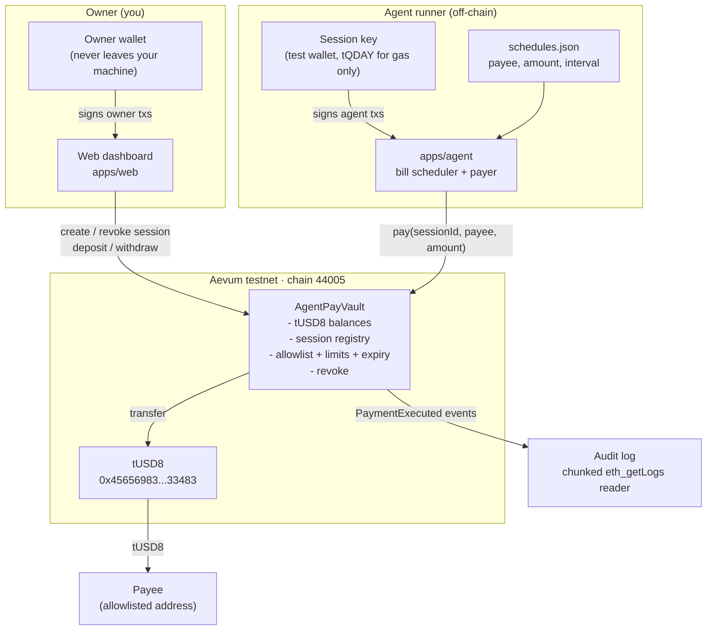
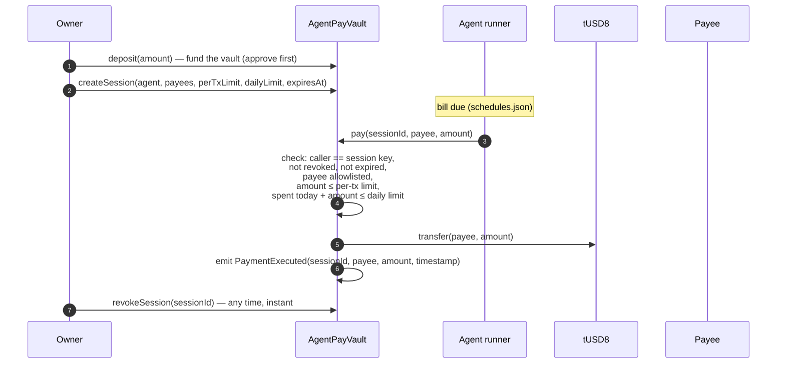

# AgentPay — autonomous stablecoin bill payments on Aevum testnet

> Entry for **Aevum Builder Challenge #1** (QDay), track **Native AI
> Assistants**. Submission deadline: **11 December 2026, 16:00 HKT
> (08:00 UTC / 15:00 WIB)**. Demo Day: 15 December 2026 (top 5 present
> live, 3–5 minutes). All code was written inside the build window
> 16 November – 11 December 2026. All contracts run on **Aevum testnet
> (chain 44005)** with test tokens only — no real funds, no mainnet.

**One-liner:** An AI agent pays your recurring bills in tUSD8 from a
vault you own — inside a payee allowlist, per-transaction and daily
spending limits, and an expiry you set — and you can revoke its access
instantly, with every payment leaving a verifiable on-chain audit trail.

- Live contract: [`AgentPayVault`
  `0x4079f1A0f75458997DCd1A768170b96086276b47`](https://explorer-test.qday.info/address/0x4079f1A0f75458997DCd1A768170b96086276b47)
  (Aevum testnet, source-verified, deployed 20 November 2026)
- Challenge: <https://qday.io/builder-challenge> ·
  <https://dorahacks.io/hackathon/qday/detail>

## The problem

Recurring payments are still manual, brittle, or over-privileged:

- Paying every subscription, invoice, or scheduled transfer by hand is
  slow and easy to miss.
- Giving an AI agent your wallet key (or an unlimited token approval)
  so it can "pay for you" hands it your whole balance. A compromised
  key, a runaway loop, or a prompt-injection attack can drain
  everything.
- Existing "agent pays" demos usually settle off-chain or on another
  network, so there is no verifiable, on-chain record of *who* paid
  *whom*, *how much*, and *under what authority*.

## The solution

AgentPay splits **money** from **permission**:

- **The vault holds the money.** tUSD8 sits in `AgentPayVault`, a
  contract owned by you. Only the owner can deposit and withdraw.
- **The agent holds a narrow session key.** The owner creates a session
  that authorises one agent address to pay **only** allowlisted payees,
  **only** up to a per-transaction limit and a daily limit (UTC-day
  window), and **only** until an expiry timestamp. The session key can
  never withdraw funds to itself, change the allowlist, or extend its
  own limits.
- **Revocation is instant and on-chain.** `revokeSession` takes effect
  in the next block; the agent's next payment reverts with
  `SessionIsRevoked`.
- **Every payment is auditable.** Each payment emits a
  `PaymentExecuted` event with the session id, payee, amount, and
  timestamp, readable from the explorer or the audit reader in this
  repo.
- **Scheduling lives off-chain; enforcement lives on-chain.** A small
  agent runner watches a bill schedule (a JSON file) and calls `pay`
  when a bill is due. If the runner is compromised or buggy, the
  contract — not the runner — is the last line of defence.

## How it works





## Live deployment

All activity is on **QDay Aevum Testnet** — chain ID **44005**
(`0xABE5`), RPC `https://rpc-test.qday.info`, explorer
<https://explorer-test.qday.info>, gas token tQDAY (18 decimals,
~1 gwei). Deployed from the contract source in commit `2eca873`.

| Contract / token | Address | Explorer |
| --- | --- | --- |
| `AgentPayVault` | `0x4079f1A0f75458997DCd1A768170b96086276b47` | [explorer](https://explorer-test.qday.info/address/0x4079f1A0f75458997DCd1A768170b96086276b47) |
| tUSD8 (ERC-20, 6 decimals) | `0x456569838f1d43009A91ebA4263147Afd7233483` | [explorer](https://explorer-test.qday.info/address/0x456569838f1d43009A91ebA4263147Afd7233483) |
| QDayFaucet | `0xE5074CBbd046AFb491EB8692abD6cF7ECCC6dEE5` | [explorer](https://explorer-test.qday.info/address/0xE5074CBbd046AFb491EB8692abD6cF7ECCC6dEE5) |
| Deployer / vault owner (test wallet) | `0xf2Cc349a7629Ef20110621f713A7153306b05651` | [explorer](https://explorer-test.qday.info/address/0xf2Cc349a7629Ef20110621f713A7153306b05651) |
| Demo session key (test wallet) | `0x19bD0bf921706F17Aa1F3C346C6328382328Ba17` | [explorer](https://explorer-test.qday.info/address/0x19bD0bf921706F17Aa1F3C346C6328382328Ba17) |
| Demo payee (test wallet) | `0xc592286d027E701A5bb0681675C1F4d80d2Ee8Cd` | [explorer](https://explorer-test.qday.info/address/0xc592286d027E701A5bb0681675C1F4d80d2Ee8Cd) |

Deployment details (20 November 2026):

- Deploy transaction:
  [`0xcef3c2f73f90af7cfa914ea6d4005523c666e380be11aa53c601059f744ccf5d`](https://explorer-test.qday.info/tx/0xcef3c2f73f90af7cfa914ea6d4005523c666e380be11aa53c601059f744ccf5d),
  block **3,648,790**, legacy (type 0) transaction, gas 1,016,383
  (~0.00102 tQDAY at 1 gwei).
- **Source-verified** on the Aevum explorer — the deployed bytecode
  matches the source in this repo. (The starter kit's note that
  explorer verification "does not work yet" is out of date.)
- The dashboard reads these addresses from [`deployments.json`](./deployments.json)
  (also copied to `apps/web/public/deployments.json`, so the built
  static site runs in live mode with no rebuild).

## Proven on testnet — what actually ran

Everything below happened on Aevum testnet on 20 November 2026 and is
verifiable from the explorer links. Both demo sessions (0 and 1) were
revoked after testing.

### End-to-end smoke test (session 0)

| Step | Result |
| --- | --- |
| Deposit 0.5 tUSD8 into the vault | ✅ |
| Create session 0: payee allowlist `[0xc592…8Cd]`, per-tx limit 0.1, daily limit 0.2 tUSD8 | ✅ |
| Pay 0.05 tUSD8 to the test payee | ✅ [tx `0x8c832d2c…`](https://explorer-test.qday.info/tx/0x8c832d2c39b3ef9109e5d9a2db09617615ed2de56e172aac6b75f7e458b3ea04) (block 3,648,923) |
| Pay over the per-tx limit | ❌ reverts, `ExceedsPerTxLimit` |
| Pay called by the owner (not the session key) | ❌ reverts, `NotSessionKey` |
| Revoke session 0, then pay again | ❌ reverts, `SessionIsRevoked` |
| Withdraw the remaining 0.45 tUSD8 | ✅ |

### Autonomous agent payments (session 1)

The agent service (`apps/agent`) paid **three times autonomously** on
live testnet via `run-once`, 0.05 tUSD8 each, under session 1
(per-tx 0.1 / daily 0.2):

| # | Transaction | Block |
| --- | --- | --- |
| 1 | [`0xeedef2e2…`](https://explorer-test.qday.info/tx/0xeedef2e21209a155fc54a37e961877c419dd259e5d7574f6549cf2894862c0d5) | 3,649,038 |
| 2 | [`0x6e73bb29…`](https://explorer-test.qday.info/tx/0x6e73bb29792b92e01e9a2dbe6910de20ce66fc9aad855f8296627b08a930c56a) | 3,649,056 |
| 3 | [`0x7eac3415…`](https://explorer-test.qday.info/tx/0x7eac3415bd74700f97278436781ef03e1168e9941a85ffbf0bd6ade6b51a9707) | 3,649,284 |

The agent run was funded by a further 0.2 tUSD8 deposit
([tx `0xda80198f…`](https://explorer-test.qday.info/tx/0xda80198fa343fbe36a6647142300183d02bbc2ca24bf66db31c1045b115f57e4),
block 3,649,011); the remaining 0.05 tUSD8 was withdrawn afterwards
([tx `0xf5965172…`](https://explorer-test.qday.info/tx/0xf596517255d79dda9f3a1338294113ee1f6eb503de666ffdb3509fe1b7b9a478),
block 3,649,308).

On-chain state of the two demo sessions (both revoked after testing, so
these values no longer change): session 0 `spentToday` 0.05 tUSD8,
session 1 `spentToday` 0.15 tUSD8. Wallet and vault balances keep
changing as live testing continues — check the explorer links above for
current values.

### A bug found by live testing — and fixed

Live testing caught a real double-pay bug: a tick that started in one
billing period and landed in the next paid **twice within 22 seconds**,
because the idempotency period key was recorded from the time the tick
*started*, not from when the payment *landed*. Fix: the period key is
now recorded from the payment's landing time. Verified live — a second
`run-once` in the same period now skips with no payment — and covered
by 3 new unit tests in `apps/agent/test/agent.test.ts`. The contract
limits were never breached: the duplicate payment was still inside the
session's per-tx and daily limits, which is exactly the defence-in-depth
the design intends.

## Demo

- **Live deployment:** the contract above, plus the dashboard in live
  mode (see [Run the dashboard](#run-the-dashboard)).
- **No-funds demo:** `npm run e2e` in `apps/agent` runs the full flow
  (deploy mock tUSD8 + vault, fund, create sessions, run the real agent
  ticks, assert on-chain outcomes) on a local anvil chain — 17/17
  checks, no testnet funds needed. See
  [Run the whole flow locally](#run-the-whole-flow-locally-no-funds-needed).
- **Demo video:** https://www.youtube.com/watch?v=luBANFwje54
- **Live demo:** https://andipangeranm142.github.io/agentpay/
  (3–5 minute walkthrough of the full flow on testnet).

## Repository layout

```text
agentpay/
├── deployments.json          # live deployment (vault, token, tx, block)
├── contracts/                # Foundry project (Solidity 0.8.24, Shanghai EVM)
│   ├── src/
│   │   ├── AgentPayVault.sol         # the vault (one contract)
│   │   └── mocks/MockUSD8.sol        # 6-decimal mock tUSD8 (local tests only)
│   ├── test/
│   │   ├── AgentPayVault.t.sol       # unit + fuzz tests (53 tests)
│   │   └── fork/AevumFork.t.sol      # fork tests vs real tUSD8 (3 tests)
│   ├── script/Deploy.s.sol           # deploy script (real tUSD8 on Aevum/fork,
│   │                                 # MockUSD8 on local anvil only)
│   ├── tools/check-shanghai.mjs      # fails the build on Cancun-only opcodes
│   ├── Makefile                      # build / test / fork / deploy shortcuts
│   └── README.md                     # contract details + Aevum rules
├── apps/
│   ├── agent/                # off-chain scheduler + payer (Node.js, TypeScript, viem)
│   │   ├── src/              # scheduler, executor, preflight, state, CLI, status server
│   │   ├── test/             # vitest suites (90 tests)
│   │   ├── scripts/e2e.ts    # anvil end-to-end script (17 checks)
│   │   ├── schedules.example.json    # bill schedule template
│   │   └── README.md         # agent details, skip reasons, layout
│   └── web/                  # owner dashboard (Vite + React + TypeScript + wagmi/viem)
│       ├── src/              # Overview / DepositWithdraw / Sessions / Activity
│       ├── public/deployments.json   # live deployment (drives live mode)
│       └── README.md         # dashboard details, mock vs live mode
└── docs/
    ├── README-DRAFT.md               # early draft (superseded by this README)
    └── DORAHACKS-SUBMISSION-DRAFT.md # submission form draft
```

## Tech stack

| Layer | Technology | Why |
| --- | --- | --- |
| Smart contracts | Solidity 0.8.24, Foundry (`forge`, `cast`, `anvil`), OpenZeppelin | Standard EVM toolchain; Aevum is EVM-compatible |
| EVM target | **Shanghai** (`evm_version = "shanghai"`) | Aevum does not support Cancun opcodes (`MCOPY`, `TSTORE`/`TLOAD`, blob ops) — Cancun bytecode deploys then reverts with `invalid opcode` |
| Token | tUSD8 (ERC-20, 6 decimals) | The challenge stablecoin on Aevum |
| Agent runner | Node.js, TypeScript, viem | Signs with the session key, polls the bill schedule |
| Dashboard | Vite + React + TypeScript + wagmi/viem | Owner UI; static build, deployable to GitHub Pages |
| Chain reads | HTTPS JSON-RPC polling, chunked `eth_getLogs` (≤ 1,000 blocks per call) | Aevum has no working WebSocket RPC, and `eth_getLogs` over > 1,000 blocks fails |
| Transactions | Legacy (type 0) | Aevum tooling sends legacy txs, like QDay's own faucet |

## Prerequisites

- **Git**
- **Foundry** (`forge`, `cast`, `anvil`) — install with
  `curl -L https://foundry.paradigm.xyz | bash` then `foundryup`.
  Version used here: Foundry 1.10.0.
- **Node.js 22+** and **npm** (tested on Node 24).
- **make** (for the `contracts/Makefile` shortcuts; every `make`
  target also has an equivalent `forge`/`cast` command in
  `contracts/README.md`).
- A test-only wallet (MetaMask or a Foundry keystore account) for the
  testnet paths. **Never use a wallet that holds real funds.** Never
  paste a private key into chat, an issue, or a committed file.

```bash
git clone --recurse-submodules https://github.com/andiPangeranm142/agentpay.git
cd agentpay
```

`--recurse-submodules` pulls in `forge-std` and
`openzeppelin-contracts` under `contracts/lib/`. If you cloned without
it, run `git submodule update --init --recursive`.

## Run the whole flow locally (no funds needed)

The fastest way to see the entire system work, with zero testnet funds
and no wallet. The e2e script starts its own anvil chain, deploys a
mock tUSD8 + the real vault, funds it, creates sessions, runs the real
agent ticks, and asserts the on-chain outcomes.

```bash
cd apps/agent
npm install
npm run e2e     # 17/17 checks, ~40 s
```

Expected output ends with `[e2e] 17/17 checks passed`, including a
daily-limit refusal and an audit trail of 3 `PaymentExecuted` events
totalling 18.0 tUSD8.

## Run the dashboard

```bash
cd apps/web
npm install
npm run dev      # http://localhost:5173
npm run build    # typecheck + static build into dist/
npm run preview  # serve the production build locally
```

- **Mock mode (default for review):** with no vault address configured
  the app shows realistic demo data, clearly bannered "Demo data" — no
  wallet or deployment needed to review the UI.
- **Live mode:** `public/deployments.json` is already in this repo and
  points at the live vault, so the built site runs live with no
  rebuild. Alternatively set `VITE_VAULT_ADDRESS` in `.env` (copy
  `.env.example` first) — `deployments.json` wins over env vars when
  both exist. All signing happens in the user's own wallet; the app
  never sees a private key.

In live mode you can: connect a wallet (Aevum testnet, chain 44005),
deposit tUSD8 (approve + deposit), create a session (allowlist editor,
per-tx + daily limits, expiry), watch the activity log, revoke a
session, and withdraw.

## Run against a local fork of Aevum (real tUSD8, no testnet funds)

This reproduces the live flow against a local copy of Aevum testnet,
using the real tUSD8 contract. Every command below was verified on
20 November 2026. The keys used are anvil's **public throwaway
defaults** — they are only safe because the fork is local and
ephemeral; never use them on testnet or mainnet.

Terminal 1 — local copy of Aevum (chain 440050, Shanghai rules):

```bash
cd contracts
make fork        # anvil on http://127.0.0.1:8555
```

Terminal 2 — deploy the vault to the fork and fund the demo owner:

```bash
cd contracts
make deploy-fork
# note the AgentPayVault address from the output, e.g. VAULT=0x5b69…

# give the demo owner (anvil account 0) 100 tUSD8 + 10 tQDAY for gas
make deal TO=0xf39Fd6e51aad88F6F4ce6aB8827279cffFb92266 AMOUNT=100
```

Terminal 2 — approve, deposit 50 tUSD8, and create session 0 for the
demo agent (anvil account 1) with payee anvil account 2, per-tx limit
10 tUSD8, daily limit 20 tUSD8, 30-day expiry (amounts are tUSD8 base
units, 6 decimals):

```bash
FORK=http://127.0.0.1:8555
VAULT=<address from make deploy-fork>
TUSD8=0x456569838f1d43009A91ebA4263147Afd7233483
OWNER_KEY=0xac0974bec39a17e36ba4a6b4d238ff944bacb478cbed5efcae784d7bf4f2ff80  # anvil account 0 (public default)

cast send $TUSD8 'approve(address,uint256)' $VAULT 100000000 --private-key $OWNER_KEY --rpc-url $FORK
cast send $VAULT 'deposit(uint256)' 50000000 --private-key $OWNER_KEY --rpc-url $FORK
cast send $VAULT 'createSession(address,address[],uint256,uint256,uint64)' \
  0x70997970C51812dc3A010C7d01b50e0d17dc79C8 \
  '[0x3C44CdDdB6a900fa2b585dd299e03d12FA4293BC]' \
  10000000 20000000 $(date -d '+30 days' +%s) \
  --private-key $OWNER_KEY --rpc-url $FORK
```

Terminal 2 — run the agent once against the fork (session key =
anvil account 1, also a public default). The schedule below pays 5.0
tUSD8 per day to the allowlisted payee from session 0:

```bash
cd ../apps/agent
npm install
cat > schedules.json <<'EOF'
[{"active":true,"amount":"5.0","every":"1d","id":"fork-rent",
  "payee":"0x3C44CdDdB6a900fa2b585dd299e03d12FA4293BC","sessionId":0}]
EOF

RPC_URL=http://127.0.0.1:8555 CHAIN_ID=440050 VAULT_ADDRESS=$VAULT \
  SESSION_KEYS_JSON='{"0":"0x59c6995e998f97a5a0044966f0945389dc9e86dae88c7a8412f4603b6b78690d"}' \
  npm run run-once
```

Expected result: the agent pays 5.0 tUSD8 to the allowlisted payee and
prints `payment success` with the transaction hash. A second
`run-once` pays nothing — the period is already paid (idempotency).
Verify on the fork (the payee's balance rises by 5,000,000 base units
from whatever the forked testnet state gave it):

```bash
cast call $TUSD8 'balanceOf(address)(uint256)' 0x3C44CdDdB6a900fa2b585dd299e03d12FA4293BC --rpc-url $FORK
```

## Get testnet funds (faucet)

To run against the real Aevum testnet you need a little tQDAY (gas,
~1 gwei per transaction — 1 tQDAY covers hundreds of transactions)
and some tUSD8.

- **Recommended: the official QDay Discord faucet.** Join
  <https://discord.gg/bYPhjmrSfK>, then run the `/faucet` slash command
  with your address. You receive **1 tQDAY + 5 tUSD8**, once per
  Discord account and once per address. No mainnet balance required.
- **Web faucet** (<https://faucet.qday.info/en>) — only pays
  addresses holding a small balance on Ethereum mainnet, so it fails
  for fresh test wallets. Use the Discord faucet instead.

## Deploy to Aevum testnet

```bash
# 1. Import the TEST deployer key into Foundry's encrypted keystore
#    (the key is asked once; a password is asked each time — never put
#    the raw key in a file or shell history)
cast wallet import agentpay-deployer --interactive
cast wallet address --account agentpay-deployer

# 2. Fund the deployer via the Discord faucet (see above).

# 3. Deploy (legacy transactions; Shanghai EVM)
cd contracts
make deploy-aevum ACCOUNT=agentpay-deployer
# equivalent: forge script script/Deploy.s.sol --rpc-url https://rpc-test.qday.info \
#   --broadcast --legacy --account agentpay-deployer

# 4. Record the deployed address, deploy tx, block, and commit hash in
#    deployments.json and in the "Live deployment" section above.
```

## Configuration

All configuration lives in environment variables. Copy each
`.env.example` to `.env` and fill it in — `.env` files are
git-ignored; never commit one. **Never put the vault owner's key in
any `.env`**: the agent only ever needs *session* keys, and the
dashboard signs in the user's wallet.

### Agent (`apps/agent/.env`)

| Variable | Required | Default | Description |
| --- | --- | --- | --- |
| `RPC_URL` | No | `https://rpc-test.qday.info` | HTTPS RPC (Aevum has no WebSocket RPC; the agent polls) |
| `CHAIN_ID` | No | `44005` | `440050` for the local fork, `31337` for local anvil |
| `VAULT_ADDRESS` | Yes | — | Deployed `AgentPayVault` |
| `TOKEN_ADDRESS` | No | `0x456569838f1d43009A91ebA4263147Afd7233483` | tUSD8 (6 decimals) |
| `SESSION_KEYS_JSON` | Yes (agent) | — | JSON map `{"0":"0x…","1":"0x…"}` of session id → session-key private key. Wins over `SESSION_KEY_<id>` |
| `SESSION_KEY_<id>` | Alt. | — | Per-session alternative, e.g. `SESSION_KEY_0=0x…` |
| `POLL_INTERVAL_MS` | No | `30000` | How often the daemon checks for due bills |
| `STATUS_PORT` | No | `3100` | Localhost-only status endpoint (`GET /status`, `GET /health`) |
| `SCHEDULES_PATH` | No | `./schedules.json` | Bill schedule the agent watches |
| `STATE_PATH` | No | `./state/agent-state.json` | Idempotency state (atomic writes; a corrupt file refuses to start) |
| `LOG_PATH` | No | `./logs/agent.log` | JSON-lines log (never contains keys) |
| `MAX_RETRIES` / `RETRY_BASE_MS` | No | `5` / `1000` | RPC-failure retries only; backoff `base * 2^attempt + jitter`. Reverts are never retried |
| `VAULT_DEPLOY_BLOCK` | No | — | First block for `history` scans |

Bill schedule format (`schedules.json`, see
`schedules.example.json`):

```json
[
  {
    "id": "rent",
    "sessionId": 0,
    "payee": "0x70997970C51812dc3A010C7d01b50e0d17dc79C8",
    "amount": "5.0",
    "every": "1d",
    "active": true
  }
]
```

`amount` is tUSD8 in human units (6 decimals). `every` accepts
intervals like `"30s"`, `"1h"`, `"1d"`, `"1w"`; `intervalSeconds` may
be used instead and wins when both are set. A schedule is due when its
current period (epoch-aligned bucket) has not been paid yet; missed
periods are **not** back-paid.

### Dashboard (`apps/web/.env`)

| Variable | Required | Default | Description |
| --- | --- | --- | --- |
| `VITE_VAULT_ADDRESS` | No | — | Deployed `AgentPayVault`. Leave empty for mock mode. `public/deployments.json` overrides this |
| `VITE_TUSD8_ADDRESS` | No | `0x456569838f1d43009A91ebA4263147Afd7233483` | tUSD8 |
| `VITE_RPC_URL` | No | `https://rpc-test.qday.info` | Aevum testnet RPC |
| `VITE_EXPLORER_URL` | No | `https://explorer-test.qday.info` | Aevum testnet explorer |

### Contracts (`contracts/.env`)

| Variable | Required | Default | Description |
| --- | --- | --- | --- |
| `AEVUM_RPC_URL` | No | `https://rpc-test.qday.info` | Aevum testnet RPC |
| `TUSD8` | No | `0x456569838f1d43009A91ebA4263147Afd7233483` | Token address (override only if needed) |
| `DEPLOYER_PRIVATE_KEY` | No | — | Fallback for the deploy script. Prefer a Foundry keystore (`cast wallet import`) instead |

## Usage

### Owner (web dashboard)

1. Connect your wallet (Aevum testnet, chain 44005).
2. **Deposit** tUSD8 into the vault (approve + deposit).
3. **Create a session**: pick the agent address, the allowlisted
   payees, the per-transaction limit, the daily limit, and the expiry.
   Sign once.
4. **Watch the activity log**: every payment appears with its explorer
   link, plus a daily-spend summary.
5. **Revoke** a session at any time — the agent's next payment reverts.
6. **Withdraw** remaining funds whenever you want.

### Agent (runner)

```bash
cd apps/agent
npm run validate   # checks env + schedules without starting
npm run build && npm start   # or: npm run dev (tsx watch)
npm run run-once   # pay all due bills once, then exit
npm run status     # print schedules + last executions from local state
npx tsx src/cli.ts history --from-block <vaultDeployBlock>  # on-chain PaymentExecuted audit trail
```

Before sending, the agent preflights every payment: it reads
`getSession`, `isPayeeAllowed`, `remainingDailyAllowance`, the vault's
tUSD8 balance, and the session key's native balance, then simulates
the exact `pay()` call off-chain. Doomed payments are skipped with a
clear reason (`SESSION_EXPIRED`, `PAYEE_NOT_ALLOWED`, `PER_TX_LIMIT`,
`DAILY_LIMIT`, `INSUFFICIENT_BALANCE`, `INSUFFICIENT_GAS`,
`NO_SESSION_KEY`) instead of burning gas. The vault contract is the
final enforcer regardless — preflight can only skip, never overpay.
Status is served at `GET http://127.0.0.1:3100/status` (localhost
only); `GET /health` is a liveness probe. Full details in
[`apps/agent/README.md`](./apps/agent/README.md).

## Contract API reference

`AgentPayVault` — `contracts/src/AgentPayVault.sol`. Session ids are
sequential `uint256`s starting at 0 (`nextSessionId` counts sessions
created). Amounts are tUSD8 base units (6 decimals). Daily limits reset
each UTC day (`block.timestamp / 1 days`).

### Owner functions

| Function | Description |
| --- | --- |
| `deposit(uint256 amount)` | Pull tUSD8 from the caller into their vault balance (caller must `approve` first). Emits `Deposited`. |
| `withdraw(uint256 amount)` | Send tUSD8 from the caller's own vault balance back to them. Emits `Withdrawn`. |
| `createSession(address sessionKey, address[] payees, uint256 perTxLimit, uint256 dailyLimit, uint64 expiry) returns (uint256 sessionId)` | Authorise a session key with a payee allowlist, per-transaction limit, daily limit (must be ≥ per-tx limit), and expiry (must be in the future). Emits `SessionCreated`. |
| `revokeSession(uint256 sessionId)` | Instantly revoke a session. Only its owner. Idempotent. Emits `SessionRevoked`. |

There is **no admin/owner backdoor**: only each owner can withdraw
their own balance, and a session key can only pay allowlisted payees
within limits.

### Agent function (only the session's key)

| Function | Description |
| --- | --- |
| `pay(uint256 sessionId, address payee, uint256 amount)` | Pay `amount` tUSD8 from the session owner's vault balance to `payee`. Reverts unless: caller is the session key, session exists, not revoked, not expired, `payee` is allowlisted, `amount ≤ perTxLimit`, `spentToday + amount ≤ dailyLimit`, and the owner's vault balance covers it. Emits `PaymentExecuted`. |

### Views

| Function | Description |
| --- | --- |
| `balances(address owner)` | Vault tUSD8 balance per owner. |
| `nextSessionId()` | Next session id to assign (also the number of sessions created). |
| `getSession(uint256 sessionId)` | Full session record: `sessionKey, owner, payees, perTxLimit, dailyLimit, spentToday, lastSpendDay, expiry, revoked, exists`. |
| `isPayeeAllowed(uint256 sessionId, address payee)` | Allowlist check (false for unknown sessions). |
| `remainingDailyAllowance(uint256 sessionId)` | How much the session may still spend today (UTC day); resets to the full daily limit on a new day. |

### Events (the audit trail)

```solidity
event Deposited(address indexed owner, uint256 amount);
event Withdrawn(address indexed owner, uint256 amount);
event SessionCreated(uint256 indexed sessionId, address indexed owner,
                     address indexed sessionKey, uint256 perTxLimit,
                     uint256 dailyLimit, uint64 expiry);
event SessionRevoked(uint256 indexed sessionId, address indexed owner);
event PaymentExecuted(uint256 indexed sessionId, address indexed payee,
                      uint256 amount, uint256 timestamp);
```

Custom errors (all 16 are in the ABIs so clients decode revert
reasons): `ZeroAmount`, `InvalidSessionKey`, `InvalidPayee`,
`NoPayees`, `InvalidPerTxLimit`, `InvalidDailyLimit`,
`InvalidExpiry`, `SessionNotFound`, `SessionIsRevoked`,
`SessionExpired`, `NotSessionKey`, `NotSessionOwner`,
`PayeeNotAllowed`, `ExceedsPerTxLimit`, `ExceedsDailyLimit`,
`InsufficientBalance`.

## Security model

- **Least privilege.** The session key can do exactly one thing: pay
  allowlisted payees within limits. It cannot withdraw, cannot change
  the allowlist or limits, cannot extend its expiry, and cannot create
  sessions.
- **Blast radius is capped.** The most a compromised session key can
  move is the daily limit, to allowlisted payees only — and only until
  the owner revokes it (one transaction) or it expires.
- **Owner key isolation.** The owner key never touches the agent host.
  The agent host holds only the session key, a test wallet with a
  little tQDAY for gas.
- **Reentrancy-guarded.** All fund-moving functions
  (`deposit`, `withdraw`, `pay`) are `nonReentrant`; token transfers
  use OpenZeppelin `SafeERC20`.
- **Idempotency.** Each billing period is keyed and persisted
  atomically after a successful payment; a restart can never
  double-pay the same period, and a corrupt state file refuses to
  start rather than risk a double-payment.
- **Auditability.** Every state change emits an event; the audit
  readers reconstruct the full history from chain data (chunked reads,
  1,000 blocks at a time).
- **No secrets in this repo.** No private key, mnemonic, `.env` file,
  or keystore is committed — `.env` files and wallet/key files are
  git-ignored, keys live only in environment variables or Foundry
  keystores, and the agent never logs a key. The only keys in the repo
  are anvil's public throwaway defaults in `.env.example` and test
  fixtures, documented as such.
- **Testnet only.** Test tokens, no real money, no mainnet deployment
  in this repo.

## Testing

All counts below were verified by running the suites on
20 November 2026.

```bash
# Contracts (from contracts/)
make build      # forge build + Shanghai opcode check
make test       # unit + fuzz tests (no network) — 53 passed
make test-fork  # fork tests vs real tUSD8 on Aevum — 3 passed
make check      # build + unit + fork

# Agent (from apps/agent/)
npm test        # unit tests (vitest) — 90 passed
npm run e2e     # end-to-end on a local anvil chain — 17/17 checks

# Dashboard (from apps/web/)
npm run build   # typecheck + static build
```

Every rule in the security model has a test: allowlist rejection,
per-tx limit, daily limit (including UTC-day reset), expiry, revoke,
non-agent caller, non-owner revoke, insufficient balance, and
double-payment/idempotency (including the period-boundary case found
in live testing).

## Platform integration notes (for the judges)

How AgentPay uses — and does not use — QDay platform features, verified
20 November 2026:

| Feature | QDay status (20 Nov 2026) | What AgentPay does |
| --- | --- | --- |
| tUSD8 payments on Aevum | Live; `0x4565…3483` | All value movement is tUSD8 on Aevum testnet (chain 44005). |
| Session keys, spending limits, expiry, revoke | QDay's agent wallets / session keys are announced as live on testnet (qday.io/build), **but no contract addresses, endpoints, or SDK are published**, and the starter kit says to write budgets, limits, expiry and revoke "into your own contract" | Implemented in `AgentPayVault` itself — the design the starter kit recommends. |
| ERC-4337 smart accounts + paymaster | Announced as live on testnet; the starter kit FAQ says there is "no officially supported bundler or paymaster" and "no public paymaster that takes tUSD8 yet" | Not used in v1; roadmap item for when addresses are published. |
| x402 facilitator | Announced as live on testnet; no endpoint published | Not used in v1; roadmap item. |
| ERC-8004 registry | Still in internal testing; "isn't open for this challenge" (starter kit); the canonical registry addresses hold no code on Aevum | Not used; AgentPay keeps its own session registry in the vault. |
| EIP-3009 gasless pattern | Works today (starter kit) | Roadmap (v1.1). |

Sources: <https://qday.io/build>,
<https://wiki.qday.info/guide/handbook/why-qday/>,
<https://aevum-starter-kit.vercel.app/docs>,
<https://dorahacks.io/hackathon/qday/detail> (all checked 20 Nov 2026).

## Known limitations

1. **Scheduling is off-chain.** The runner must be running for bills to
   be paid; there is no on-chain cron on Aevum. If the runner is down,
   bills wait (and missed periods are not back-paid). (Roadmap: a
   keeper network / automation service.)
2. **No public paymaster / bundler (yet).** The starter kit confirms
   there is no officially supported bundler or paymaster and no public
   paymaster that takes tUSD8, so the agent pays gas in tQDAY. Gasless
   payment via EIP-3009 + relayer is a roadmap item, not v1.
3. **QDay's ERC-8004 registry is not open.** It is still in internal
   testing and "isn't open for this challenge", so AgentPay does not
   depend on it.
4. **Shanghai EVM.** No Cancun opcodes; OpenZeppelin `*Transient`
   contracts are unusable.
5. **Log reads are chunked.** `eth_getLogs` fails over > 1,000 blocks;
   the audit readers chunk from the deploy block.
6. **No WebSocket RPC** (per the starter kit). The dashboard and runner
   poll over HTTPS.
7. **Single owner per vault (v1).** No multisig owner yet.
8. **Testnet only.** tUSD8 has no real value; nothing here is a
   production payment system.

## Roadmap

- [ ] **v1.1 — Gasless agent payments.** EIP-3009
      `receiveWithAuthorization` + relayer (the starter kit's gasless
      checkout pattern), so the session key needs no tQDAY.
- [ ] **v1.2 — ERC-4337 smart account.** Adopt QDay's smart accounts /
      paymaster **when** QDay publishes bundler + paymaster addresses
      and docs.
- [ ] **v1.3 — x402 bills.** Pay-per-use API bills through QDay's x402
      facilitator once its endpoint is published.
- [ ] **v1.4 — Keeper network.** Decentralised scheduling so bills are
      paid even if the owner's runner is offline.
- [ ] **v2 — Multisig owner, multi-vault, ERC-8004 reputation.**
      Reputation feedback for agents; mainnet when QDay mainnet
      launches (scheduled Q1 2027).

## License

MIT — see [`LICENSE`](./LICENSE). Copyright (c) 2026 Andi Pangeran.

## Credits

- Chunked event reading follows the pattern of `getLogsChunked` from
  the Aevum Starter Kit (MIT, © 2026 PQA Labs,
  <https://github.com/qday-io/aevum-starter-kit>), reimplemented here;
  `contracts/tools/check-shanghai.mjs` is adapted from the starter kit
  (MIT).
- QDay / Aevum testnet, tUSD8, and the challenge organisers.
- OpenZeppelin Contracts (MIT), Foundry (MIT/Apache-2.0), viem/wagmi
  (MIT).

---

*Built for Aevum Builder Challenge #1 · Native AI Assistants track ·
QDay Aevum Testnet (chain 44005) · testnet only, no real funds.*
