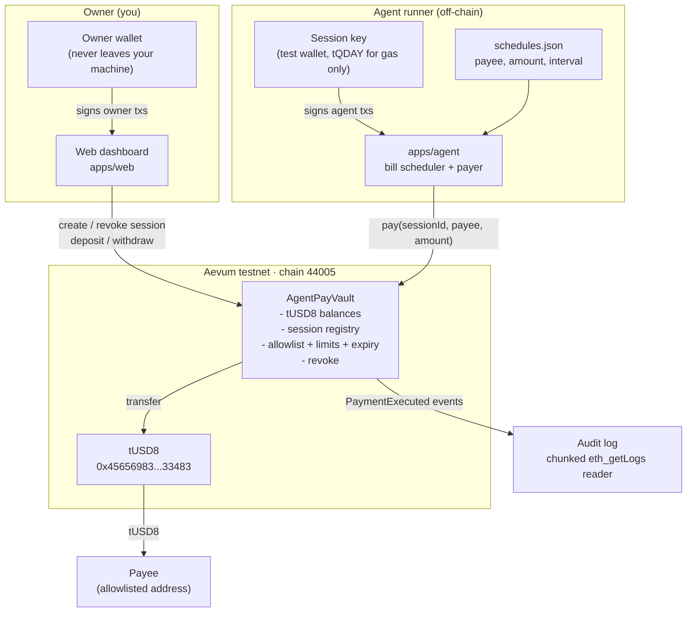
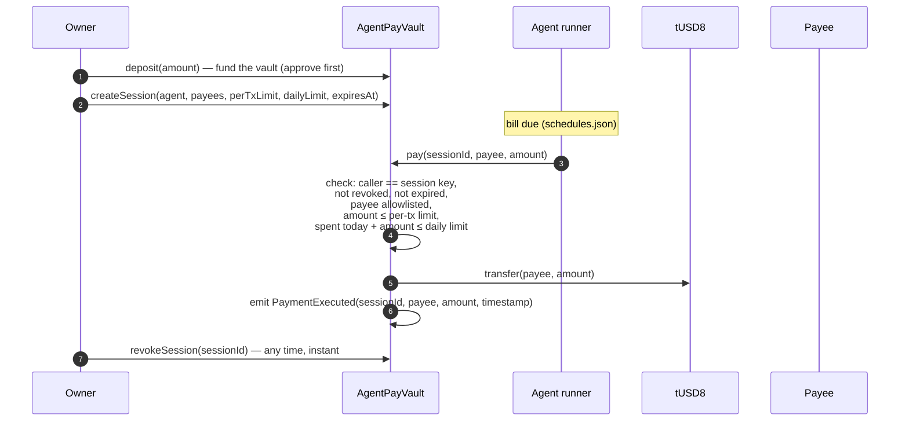

# AgentPay — autonomous stablecoin bill payments on Aevum testnet

> Entry for **Aevum Builder Challenge #1** (QDay), track **Native AI
> Assistants**. Submission deadline: **11 December 2026, 16:00 HKT
> (08:00 UTC / 15:00 WIB)**. Demo Day: 15 December 2026 (top 5 present
> live, 3–5 minutes). All code was written inside the build window
> 16 November – 11 December 2026. All contracts run on **Aevum testnet
> (chain 44005)** with test tokens only — no real funds, no mainnet.

**One-liner:** An AI agent pays your recurring bills in tUSD8 from a
vault you own — inside a payee allowlist, per-transaction and daily
spending limits, and an expiry you set — and you can revoke its access
instantly, with every payment leaving a verifiable on-chain audit trail.

- **Current — v3, case-insensitive Confirmation of Payee:**
  [`PayeeRegistryV3`
  `0x75d65168A8aB54dF423E350e306FAB438A312dB4`](https://explorer-test.qday.info/address/0x75d65168A8aB54dF423E350e306FAB438A312dB4)
  +
  [`AgentPayVaultV3`
  `0xd17e08cD03b074a9f2e1f6a69CcD239FA7C24E2e`](https://explorer-test.qday.info/address/0xd17e08cD03b074a9f2e1f6a69CcD239FA7C24E2e)
  (both source-verified, deployed 21 November 2026) — the name check
  is now case-insensitive ("kedai kopi senja" pays "Kedai Kopi Senja"), names
  are unique per owner with a reverse lookup, and session creation
  fails fast on unregistered payees. See
  [v3 — Case-insensitive Confirmation of
  Payee](#v3--case-insensitive-confirmation-of-payee).
- **Previous — v2, Confirmation of Payee:**
  [`PayeeRegistry`
  `0x5e1c3E6dcAfe32Df42B80277141b9F87C5FF6053`](https://explorer-test.qday.info/address/0x5e1c3e6dcafe32df42b80277141b9f87c5ff6053)
  +
  [`AgentPayVaultV2`
  `0xE68518A95cbbBD75f521C86688770a98140fE06F`](https://explorer-test.qday.info/address/0xE68518A95cbbBD75f521C86688770a98140fE06F)
  (both source-verified, deployed 21 November 2026) — the vault
  checks the payee's *name* against the owner's registry before
  paying, and each session caps spending per payee. See
  [v2 — Confirmation of Payee](#v2--confirmation-of-payee).
- **v1 (superseded):**
  [`AgentPayVault`
  `0x4079f1A0f75458997DCd1A768170b96086276b47`](https://explorer-test.qday.info/address/0x4079f1A0f75458997DCd1A768170b96086276b47)
  (Aevum testnet, source-verified, deployed 20 November 2026) —
  still live and unchanged, superseded by v2/v3.
- Challenge: <https://qday.io/builder-challenge> ·
  <https://dorahacks.io/hackathon/qday/detail>

## The problem

Recurring payments are still manual, brittle, or over-privileged:

- Paying every subscription, invoice, or scheduled transfer by hand is
  slow and easy to miss.
- Giving an AI agent your wallet key (or an unlimited token approval)
  so it can "pay for you" hands it your whole balance. A compromised
  key, a runaway loop, or a prompt-injection attack can drain
  everything.
- Existing "agent pays" demos usually settle off-chain or on another
  network, so there is no verifiable, on-chain record of *who* paid
  *whom*, *how much*, and *under what authority*.

## The solution

AgentPay splits **money** from **permission**:

- **The vault holds the money.** tUSD8 sits in `AgentPayVault`, a
  contract owned by you. Only the owner can deposit and withdraw.
- **The agent holds a narrow session key.** The owner creates a session
  that authorises one agent address to pay **only** allowlisted payees,
  **only** up to a per-transaction limit and a daily limit (UTC-day
  window), and **only** until an expiry timestamp. The session key can
  never withdraw funds to itself, change the allowlist, or extend its
  own limits.
- **Revocation is instant and on-chain.** `revokeSession` takes effect
  in the next block; the agent's next payment reverts with
  `SessionIsRevoked`.
- **v2 — Confirmation of Payee.** Before a v2 payment moves any tUSD8,
  the vault checks the payee's name against the owner's registry: the
  agent must pass the exact registered name for the payee address. A
  typo'd name reverts with `PayeeNameMismatch`; an address with no
  registered name — e.g. a lookalike address with one character
  changed — reverts with `PayeeNotRegistered`. Names are per-owner,
  exact and case-sensitive, and the session key can never rename a
  payee. V2 sessions also carry a **per-payee spend cap**: a cumulative
  limit per payee over the session's life, on top of the per-tx and
  daily limits.
- **v3 — Case-insensitive Confirmation of Payee.** The name check
  now ignores case: the agent may pass "kedai kopi senja" for the
  registered "Kedai Kopi Senja" — the registry compares `keccak256` of
  the ASCII-lowercased name while keeping the original case for
  display. Names are unique within each owner's namespace
  (registering "KEDAI KOPI SENJA" when "Kedai Kopi Senja" is taken reverts
  `NameAlreadyTaken`), a reverse lookup `addressOf(owner, name)`
  resolves a name to its payee in any case, and `createSession`
  fails fast — a session listing an unregistered payee reverts
  `PayeeNotRegistered` at creation instead of failing at the first
  payment. All v1/v2 limits, expiry, and revocation semantics are
  preserved.
- **Every payment is auditable.** Each payment emits a
  `PaymentExecuted` event with the session id, payee, amount, and
  timestamp, readable from the explorer or the audit reader in this
  repo.
- **Scheduling lives off-chain; enforcement lives on-chain.** A small
  agent runner watches a bill schedule (a JSON file) and calls `pay`
  when a bill is due. If the runner is compromised or buggy, the
  contract — not the runner — is the last line of defence.

## How it works





## Live deployment

All activity is on **QDay Aevum Testnet** — chain ID **44005**
(`0xABE5`), RPC `https://rpc-test.qday.info`, explorer
<https://explorer-test.qday.info>, gas token tQDAY (18 decimals,
~1 gwei). All contracts were deployed from the source in this repo
(v1: commit `2eca873`; v2: commit `a2ba272`; v3: commit `0a9540d`).

| Contract / token | Address | Explorer |
| --- | --- | --- |
| `PayeeRegistryV3` (v3 — **current**) | `0x75d65168A8aB54dF423E350e306FAB438A312dB4` | [explorer](https://explorer-test.qday.info/address/0x75d65168A8aB54dF423E350e306FAB438A312dB4) |
| `AgentPayVaultV3` (v3 — **current**) | `0xd17e08cD03b074a9f2e1f6a69CcD239FA7C24E2e` | [explorer](https://explorer-test.qday.info/address/0xd17e08cD03b074a9f2e1f6a69CcD239FA7C24E2e) |
| `AgentPayVault` (v1 — superseded) | `0x4079f1A0f75458997DCd1A768170b96086276b47` | [explorer](https://explorer-test.qday.info/address/0x4079f1A0f75458997DCd1A768170b96086276b47) |
| `PayeeRegistry` (v2 — previous) | `0x5e1c3E6dcAfe32Df42B80277141b9F87C5FF6053` | [explorer](https://explorer-test.qday.info/address/0x5e1c3e6dcafe32df42b80277141b9f87c5ff6053) |
| `AgentPayVaultV2` (v2 — previous) | `0xE68518A95cbbBD75f521C86688770a98140fE06F` | [explorer](https://explorer-test.qday.info/address/0xE68518A95cbbBD75f521C86688770a98140fE06F) |
| tUSD8 (ERC-20, 6 decimals) | `0x456569838f1d43009A91ebA4263147Afd7233483` | [explorer](https://explorer-test.qday.info/address/0x456569838f1d43009A91ebA4263147Afd7233483) |
| QDayFaucet | `0xE5074CBbd046AFb491EB8692abD6cF7ECCC6dEE5` | [explorer](https://explorer-test.qday.info/address/0xE5074CBbd046AFb491EB8692abD6cF7ECCC6dEE5) |
| Deployer / vault owner (test wallet) | `0xf2Cc349a7629Ef20110621f713A7153306b05651` | [explorer](https://explorer-test.qday.info/address/0xf2Cc349a7629Ef20110621f713A7153306b05651) |
| Demo session key (test wallet, current) | `0xe778B0b2BF7507E2a873c1E99318f3A33Efaa4c0` | [explorer](https://explorer-test.qday.info/address/0xe778B0b2BF7507E2a873c1E99318f3A33Efaa4c0) |
| Demo payee (test wallet) | `0xc592286d027E701A5bb0681675C1F4d80d2Ee8Cd` | [explorer](https://explorer-test.qday.info/address/0xc592286d027E701A5bb0681675C1F4d80d2Ee8Cd) |

The demo session key was rotated on 21 November 2026: the previous key
`0x19bD0bf921706F17Aa1F3C346C6328382328Ba17` was revoked after its
private key was briefly exposed in a public deploy, and all sessions
that used it (v1 sessions 0–3, v2 sessions 0–3, v3 sessions 0–2) are
revoked. The historical runs below still show the old address as the
session key of those revoked sessions — that on-chain history is not
rewritten. All future flows use the new key above.

Deployment details (20 November 2026):

- Deploy transaction:
  [`0xcef3c2f73f90af7cfa914ea6d4005523c666e380be11aa53c601059f744ccf5d`](https://explorer-test.qday.info/tx/0xcef3c2f73f90af7cfa914ea6d4005523c666e380be11aa53c601059f744ccf5d),
  block **3,648,790**, legacy (type 0) transaction, gas 1,016,383
  (~0.00102 tQDAY at 1 gwei).
- **Source-verified** on the Aevum explorer — the deployed bytecode
  matches the source in this repo. (The starter kit's note that
  explorer verification "does not work yet" is out of date.)
- The dashboard reads these addresses from [`deployments.json`](./deployments.json)
  (also copied to `apps/web/public/deployments.json`, so the built
  static site runs in live mode with no rebuild).

Deployment details (21 November 2026, v2):

- PayeeRegistry deploy transaction:
  [`0xe6727aea…`](https://explorer-test.qday.info/tx/0xe6727aea837fa2a6efb36740c9be664528f344426e17c376b1f62e72716828e8),
  block **3,730,439**, gas 682,015.
- AgentPayVaultV2 deploy transaction:
  [`0xd6418c85…`](https://explorer-test.qday.info/tx/0xd6418c855719d00fbe777b5f325f5a5b67d489c81c5bcb6ec6a77563058d0bbb),
  block **3,730,440**, gas 1,260,072. Constructor args: tUSD8 +
  PayeeRegistry address above.
- Total v2 deploy cost ≈ 0.00194 tQDAY at 1 gwei. Both contracts are
  **source-verified** (`forge verify-check` returned "Pass - Verified"
  for both; compiler `v0.8.24+commit.e11b9ed9`).
- The v1 vault was **not touched** by the v2 deployment — v1 sessions,
  balances, and history are unchanged; v2 is a separate vault with its
  own session ids (starting again at 0).

Deployment details (21 November 2026, v3):

- PayeeRegistryV3 deploy transaction:
  [`0x723879bb…`](https://explorer-test.qday.info/tx/0x723879bb3b09fead5505a631a5ee9c3bc2845ecdabc7debebc584d752b665b9e),
  block **3,740,129**, gas 1,006,244.
- AgentPayVaultV3 deploy transaction:
  [`0xf00d65cb…`](https://explorer-test.qday.info/tx/0xf00d65cb1b7b8608b7d902633c07ef1e18e95e2a3fc7356bb4597f5150d3b445),
  block **3,740,129**, gas 1,390,539. Constructor args: tUSD8 +
  PayeeRegistryV3 address above.
- Total v3 deploy cost ≈ 0.00240 tQDAY at 1 gwei. Both contracts are
  **source-verified** (`forge verify-contract --watch` returned "Pass
  - Verified" for both, and the explorer API returns
  `is_verified: true` with the correct contract names; compiler
  `v0.8.24+commit.e11b9ed9`). Deployed from commit `0a9540d`.
- The v1 and v2 vaults were **not touched** by the v3 deployment —
  v1/v2 sessions, balances, and history are unchanged; v3 is a
  separate vault with its own session ids (starting again at 0).

## Proven on testnet — what actually ran

Everything below happened on Aevum testnet on 20 November 2026 and is
verifiable from the explorer links. Four demo sessions (0–3) were
created that day; all four were revoked after testing. Together they
made six payments of 0.05 tUSD8 each (sessions 0–3 paid 1, 3, 1 and
1 times).

### End-to-end smoke test (session 0)

| Step | Result |
| --- | --- |
| Deposit 0.5 tUSD8 into the vault | ✅ |
| Create session 0: payee allowlist `[0xc592…8Cd]`, per-tx limit 0.1, daily limit 0.2 tUSD8 | ✅ |
| Pay 0.05 tUSD8 to the test payee | ✅ [tx `0x8c832d2c…`](https://explorer-test.qday.info/tx/0x8c832d2c39b3ef9109e5d9a2db09617615ed2de56e172aac6b75f7e458b3ea04) (block 3,648,923) |
| Pay over the per-tx limit | ❌ reverts, `ExceedsPerTxLimit` |
| Pay called by the owner (not the session key) | ❌ reverts, `NotSessionKey` |
| Revoke session 0, then pay again | ❌ reverts, `SessionIsRevoked` |
| Withdraw the remaining 0.45 tUSD8 | ✅ |

### Autonomous agent payments (session 1)

The agent service (`apps/agent`) paid **three times autonomously** on
live testnet via `run-once`, 0.05 tUSD8 each, under session 1
(per-tx 0.1 / daily 0.2):

| # | Transaction | Block |
| --- | --- | --- |
| 1 | [`0xeedef2e2…`](https://explorer-test.qday.info/tx/0xeedef2e21209a155fc54a37e961877c419dd259e5d7574f6549cf2894862c0d5) | 3,649,038 |
| 2 | [`0x6e73bb29…`](https://explorer-test.qday.info/tx/0x6e73bb29792b92e01e9a2dbe6910de20ce66fc9aad855f8296627b08a930c56a) | 3,649,056 |
| 3 | [`0x7eac3415…`](https://explorer-test.qday.info/tx/0x7eac3415bd74700f97278436781ef03e1168e9941a85ffbf0bd6ade6b51a9707) | 3,649,284 |

The agent run was funded by a further 0.2 tUSD8 deposit
([tx `0xda80198f…`](https://explorer-test.qday.info/tx/0xda80198fa343fbe36a6647142300183d02bbc2ca24bf66db31c1045b115f57e4),
block 3,649,011); the remaining 0.05 tUSD8 was withdrawn afterwards
([tx `0xf5965172…`](https://explorer-test.qday.info/tx/0xf596517255d79dda9f3a1338294113ee1f6eb503de666ffdb3509fe1b7b9a478),
block 3,649,308).

### Later sessions (sessions 2–3)

Two more sessions were created later the same day (per-tx limit 0.05,
daily limit 0.10 tUSD8), each paying once, 0.05 tUSD8 to the same test
payee:

| Session | Transaction | Block |
| --- | --- | --- |
| 2 | [`0x082b71a0…`](https://explorer-test.qday.info/tx/0x082b71a04698f7ae91fa6fa834578920b781902c86caf0c5bf9e646eba1c23e2) | 3,654,767 |
| 3 | [`0xe7fba4b0…`](https://explorer-test.qday.info/tx/0xe7fba4b08614c4a3c3b968c3fc180839f92acfc3e52d76fb82c9bb324cd8b156) | 3,655,307 |

Both sessions were revoked afterwards (blocks 3,654,791 and 3,655,331),
so all four v1 sessions are revoked and the v1 vault emitted six
`PaymentExecuted` events in total (verified via chunked `eth_getLogs`,
`nextSessionId` = 4).

On-chain state of the four demo sessions (all revoked after testing, so
these values no longer change): session 0 `spentToday` 0.05 tUSD8,
session 1 `spentToday` 0.15 tUSD8, sessions 2 and 3 `spentToday`
0.05 tUSD8 each. Wallet and vault balances keep
changing as live testing continues — check the explorer links above for
current values.

### A bug found by live testing — and fixed

Live testing caught a real double-pay bug: a tick that started in one
billing period and landed in the next paid **twice within 22 seconds**,
because the idempotency period key was recorded from the time the tick
*started*, not from when the payment *landed*. Fix: the period key is
now recorded from the payment's landing time. Verified live — a second
`run-once` in the same period now skips with no payment — and covered
by 3 new unit tests in `apps/agent/test/agent.test.ts`. The contract
limits were never breached: the duplicate payment was still inside the
session's per-tx and daily limits, which is exactly the defence-in-depth
the design intends.

## v2 — Confirmation of Payee

### How the name check works

`AgentPayVaultV2.pay(sessionId, payee, amount, expectedName)` reads
`registry.nameOf(sessionOwner, payee)` — the name **the session's
owner** registered for that payee, in the owner's own namespace. An
empty stored name reverts `PayeeNotRegistered(payee)`; otherwise the
vault compares `keccak256(expectedName)` with the stored name's hash
and a mismatch reverts `PayeeNameMismatch(expectedHash,
registeredHash)`. Comparison is exact and case-sensitive (v3 relaxes
this to case-insensitive — see below); names are
capped at 64 bytes. The session key can never register, update, or
remove a name — only the owner can, in their own namespace. The
registry is a private address book per owner, not a global registry —
the same name may exist in different owners' namespaces; see
[Namespace trade-off (v2 and
v3)](#namespace-trade-off-v2-and-v3).

Check order inside `pay`: session exists → caller is the session key
→ not revoked → not expired → payee on allowlist → amount > 0 →
within per-tx limit → **Confirmation of Payee** → per-payee cap →
daily limit → owner balance. The per-payee cap (`perPayeeCap`, set at
session creation, must be ≥ the per-tx limit) is cumulative per
(session, payee) over the session's life, tracked in `spentPerPayee`;
over-cap reverts `ExceedsPerPayeeCap`. View helper:
`remainingPayeeAllowance(sessionId, payee)`.

### Proven on testnet — v2 end-to-end run (21 November 2026)

Everything below happened on Aevum testnet on 21 November 2026 and is
verifiable from the explorer links. Session parameters: per-tx limit
0.10 tUSD8, daily limit 0.20 tUSD8, per-payee cap 0.15 tUSD8, expiry
+24h. The lookalike address used is
`0xc592286d027E701A5bb0681675C1F4d80d2Ee8Ce` — the real payee's
address with the last hex character changed.

| # | Step | Transaction | Block | Result |
| --- | --- | --- | --- | --- |
| 1 | Deposit 0.40 tUSD8 into the v2 vault | [`0x08951d79…`](https://explorer-test.qday.info/tx/0x08951d792055d20394e2c5b1b94d9fd2ddafa9dc193906438680d1f65772a75a) | 3,730,490 | ✅ |
| 2 | Register payee "Sari Bakery" → `0xc592…Ee8Cd` | [`0xaf6590f4…`](https://explorer-test.qday.info/tx/0xaf6590f401888038b5d6e0c1b3a732ff7e1d2ddc98e1b15f059f51e87805765d) | 3,730,496 | ✅ |
| 3 | Create v2 session 0 (limits above) | [`0x3c115ff3…`](https://explorer-test.qday.info/tx/0x3c115ff3899f5aec123b696df7862b849adeacd860386e3aac6d7bd8f1b14a6d) | 3,730,502 | ✅ |
| 4 | Pay 0.05 tUSD8, name "Sari Bakery" | [`0xad45efe0…`](https://explorer-test.qday.info/tx/0xad45efe0db4e36285a608386e6e4fa520b0ffda6ff4db3bba9be3f051ecab2a5) | 3,730,507 | ✅ name verified |
| 5 | Revoke sessions 0–1, withdraw 0.35 tUSD8 | [withdraw `0xeb5b613b…`](https://explorer-test.qday.info/tx/0xeb5b613bdc879d7fd214fc8c170afad7886f6251aadfcc3e46fbbb3a92975be7) | 3,730,535 | ✅ |
| 6 | Pay 0.05, wrong name "Sari Bakrey" (session 2, created for the on-chain proof) | [`0x10f6ab90…`](https://explorer-test.qday.info/tx/0x10f6ab903215a582825ddd30c6a4bc68c8976f0ed504d7cc5cfa8bd64adbfd04) | 3,730,568 | ❌ reverted on-chain (status 0x0), `PayeeNameMismatch` |
| 7 | Pay 0.05 to lookalike `…Ee8Ce`, name "Sari Bakery" (session 3) | [`0x5d3e1dc9…`](https://explorer-test.qday.info/tx/0x5d3e1dc927b9d24f75782c6b45db5666e8381bbe7d84a1edb0538a2e432bcb58) | 3,730,575 | ❌ reverted on-chain (status 0x0), `PayeeNotRegistered` |
| 8 | Revoke sessions 2–3 | — | 3,730,582 / 3,730,587 | ✅ |

The two rejections were forced on-chain with an explicit gas limit
(`cast` refuses to broadcast a call it knows will revert, so the first
attempts died at gas estimation); the revert reasons were confirmed by
`cast run` replay of the receipts. End state after the run (verified
by `cast call`, 21 Nov 2026): owner **4.65 tUSD8** (0.40 deposited,
0.05 paid, 0.35 withdrawn), payee **0.35 tUSD8** (only the verified
payment arrived), v2 vault balance **0**, `spentPerPayee(session 0,
payee)` **0.05**, all 4 v2 sessions revoked. Balances keep changing as
live testing continues — check the explorer links above for current
values. The dashboard's **Payees · CoP (v3)** tab shows the v2 registry
and run below as labelled history: the registered payees live from the
registry, the name-verified payment, and both rejections with their
explorer receipts.

## v3 — Case-insensitive Confirmation of Payee

V3 keeps every v2 behaviour and fixes the sharpest edge of exact-name
matching: a payment should not fail because the agent wrote "kedai kopi
senja" instead of "Kedai Kopi Senja". Three changes, all in the new
contracts `PayeeRegistryV3` + `AgentPayVaultV3` — the v1/v2 contracts
and tests are untouched.

### How case-insensitive matching works

`PayeeRegistryV3` stores each registered name **exactly as
registered** (for display, via `nameOf`) and compares names by
`keccak256` of a normalized form: `normalize()` lowercases ASCII
`A`–`Z` only (bytes 0x41–0x5A, +32). `AgentPayVaultV3.pay` compares
the normalized hash of `expectedName` against the stored name's
normalized hash, so "kedai kopi senja", "KEDAI KOPI SENJA", and "KeDaI KoPi SeNjA"
all pay the registered "Kedai Kopi Senja" — while a genuinely different
name ("Kedai Kopi Senaj") still reverts `PayeeNameMismatch`, now with the
*normalized* hashes. The public pure helpers `normalize` and
`normalizedHash` let clients compute the same values off-chain.

**Documented limits of normalization** (by design, not by accident):

- **ASCII only.** Only `A`–`Z` are folded. Non-ASCII letters are not
  folded, so "CAFÉ" does **not** match "café" — the `É`/`é` bytes
  pass through unchanged and the hashes differ. Full Unicode case
  folding on-chain is out of scope: it needs large lookup tables and
  locale rules that do not belong in a payment check.
- **No whitespace trimming.** Leading or trailing spaces are part of
  the name, so " Kedai Kopi Senja" or "Kedai Kopi Senja " do **not** match
  "Kedai Kopi Senja". The registry stores exactly what the owner
  registered; trimming is a client concern.
- Names are still capped at 64 bytes, as in v2.

### Reverse lookup and per-owner name uniqueness

`addressOf(owner, name)` is a view that resolves a name to its
payee address — case-insensitively — and returns `address(0)` when
no payee holds that name in that owner's namespace. It is keyed on
`mapping(owner => mapping(normalizedHash => payee))`, so a client
can turn a human-readable name into an address without scanning
events.

Within one owner's namespace, a (normalized) name may belong to only
one payee: registering — or renaming to — a name another payee
already holds reverts `NameAlreadyTaken(holder)`, where `holder` is
the payee that owns the name. `updatePayee` moves the reverse entry
(the old name is freed, the new name resolves; renaming to a name
that only differs in case is allowed), and `removePayee` deletes the
reverse entry and frees the name.

### Fail-fast session creation

`AgentPayVaultV3.createSession` checks
`registry.isRegistered(msg.sender, payee)` for every payee and
reverts `PayeeNotRegistered(payee)` when any payee is unregistered
in the creator's namespace — and `nextSessionId` does not advance,
so no session id is consumed by the failed call. A session that
could never pay anyone is refused at creation instead of failing at
the first payment. The pay-time check is kept as defence in depth:
a payee removed from the registry *after* session creation still
cannot be paid.

Check order inside `pay` is unchanged from v2: session exists →
caller is the session key → not revoked → not expired → payee on
allowlist → amount > 0 → within per-tx limit → **Confirmation of
Payee (now case-insensitive)** → per-payee cap → daily limit →
owner balance.

### Namespace trade-off (v2 and v3)

The registry is a **private address book per owner, not a public or
global registry** — and that is a deliberate design decision, not a
gap:

- Each owner has their own namespace. The same name ("Kedai Kopi Senja")
  can be registered by different owners for different addresses, and
  each owner's payments check only **their own** namespace
  (`nameOf(sessionOwner, payee)`). No owner can see, overwrite, or
  squat another owner's names.
- **Uniqueness applies only inside one namespace.**
  `NameAlreadyTaken` fires only when another payee in the *same*
  owner's namespace already holds the (normalized) name. There is no
  global first-come-first-served name market — no name squatting, no
  front-running of popular names, and no need for a name-auction or
  dispute mechanism.
- **Privacy.** A payee list is a private fact about who an owner
  pays; a global registry would publish every owner's payees under
  one searchable namespace. Per-owner namespaces keep that
  association visible only to whoever already knows the owner.
- The trade-off is that a name is only meaningful *relative to its
  owner*: "Kedai Kopi Senja" in Alice's namespace and "Kedai Kopi Senja" in
  Bob's namespace may be different addresses, and a client must
  always resolve names with the owner's address
  (`addressOf(owner, name)`). That is the correct semantics for a
  Confirmation-of-Payee check, which answers "is this the payee
  *you* meant?" — not "is this a globally famous name?"

### Proven on testnet — v3 end-to-end run (21 November 2026)

Everything below happened on Aevum testnet on 21 November 2026 and
is verifiable from the explorer links. Session parameters: per-tx
limit 0.10 tUSD8, daily limit 0.20 tUSD8, per-payee cap 0.15 tUSD8,
expiry +24h. The lookalike address used is
`0xc592286d027E701A5bb0681675C1F4d80d2Ee8Ce` — the real payee's
address with the last hex character changed.

| # | Step | Transaction | Block | Result |
| --- | --- | --- | --- | --- |
| 1 | Rename payee to "Kedai Kopi Senja" (`updatePayee`) | [`0x559d25fa…`](https://explorer-test.qday.info/tx/0x559d25fa9ba7f6f791cc29bdb6749261b4adf3b32ad052d64e64975bd7ba8596) | 3,741,044 | ✅ `nameOf` = "Kedai Kopi Senja", `addressOf("kedai kopi senja")` = payee, old name freed |
| 2 | Approve v3 vault 0.40 tUSD8 (owner) | [`0x5509d716…`](https://explorer-test.qday.info/tx/0x5509d716f5b37e6d445dc0e8efe12aeabb5798fd876d123463fc73ef6a8794fe) | 3,741,065 | ✅ |
| 3 | Deposit 0.40 tUSD8 into the v3 vault | [`0x32d4def8…`](https://explorer-test.qday.info/tx/0x32d4def8405fa1bf3c86ef3ffa17f8a46eb6fb549db8f5d8a41dfb6679cd56a3) | 3,741,070 | ✅ vault balance 0.40 |
| 4 | Create v3 session 1 (limits above) | [`0xa94ad216…`](https://explorer-test.qday.info/tx/0xa94ad2163ac3f283d06b301bb365fefad982e1be45919da36caf2923fd98b465) | 3,741,082 | ✅ |
| 5 | Pay 0.05 tUSD8, name **"kedai kopi senja"** (lowercase) | [`0xaa426288…`](https://explorer-test.qday.info/tx/0xaa426288359993ec741b60401e34a12663a07ebbf8014bc274913ef6549dadbe) | 3,741,093 | ✅ name verified case-insensitively |
| 6 | Pay 0.05, typo name "Kedai Kopi Senaj" | [`0xad8466f3…`](https://explorer-test.qday.info/tx/0xad8466f3a59190f828c8b86f4c29ff079073b181479d93e9327243a56ba177e6) | 3,741,107 | ❌ reverted on-chain (status 0x0), `PayeeNameMismatch` |
| 7 | Register duplicate name "KEDAI KOPI SENJA" for lookalike | [`0x32baa338…`](https://explorer-test.qday.info/tx/0x32baa3382afceb645d7aad456d6de9e129c64769211f1f4173e97e930912b706) | 3,741,125 | ❌ reverted on-chain (status 0x0), `NameAlreadyTaken` |
| 8 | Create session with UNREGISTERED payee (lookalike) | [`0xffbc584c…`](https://explorer-test.qday.info/tx/0xffbc584cf45b981b8bf89b7f226ab1e954ed4ad770c3565d792d662447d6bcec) | 3,741,142 | ❌ reverted on-chain (status 0x0), `PayeeNotRegistered` |
| 9 | Register lookalike under temp name "Kedai Kopi Senja 2" | [`0x18c91e5b…`](https://explorer-test.qday.info/tx/0x18c91e5bf4b0c0a7fd88c036968f0ac0f0312893c596efc6ba3ce5e2d7d29b07) | 3,741,158 | ✅ setup for step 12 |
| 10 | Create v3 session 2 with lookalike on the allowlist | [`0x661fe193…`](https://explorer-test.qday.info/tx/0x661fe19382e74264a7a3f3bb83ed5f0d28223f416af0d0f9c1f2efc645f18040) | 3,741,165 | ✅ |
| 11 | Remove lookalike from the registry (`removePayee`) | [`0x66ba69ae…`](https://explorer-test.qday.info/tx/0x66ba69ae8bd35dcb3e6b14e8166de4d19f41d04559a976467551dbacf7a067ef) | 3,741,177 | ✅ lookalike unregistered, temp name freed |
| 12 | Pay 0.05 to the removed lookalike (session 2) | [`0xf4de0c38…`](https://explorer-test.qday.info/tx/0xf4de0c3824f0f585388061e57c50cde3723862349ca5fe9219d952fc5588db37) | 3,741,185 | ❌ reverted on-chain (status 0x0), `PayeeNotRegistered` — defence in depth |
| 13 | Revoke session 1 | [`0x0653ec89…`](https://explorer-test.qday.info/tx/0x0653ec89ef5f6c83919b3531d28ed4d7896615b54992bed38786fb0001b035f5) | 3,741,202 | ✅ |
| 14 | Revoke session 2 | [`0x7edee684…`](https://explorer-test.qday.info/tx/0x7edee6843af280849c1a344a5f838c7ebce2006fc0ad0457593a35eba3b0f4ac) | 3,741,207 | ✅ |
| 15 | Withdraw 0.35 tUSD8 | [`0xa7975fe6…`](https://explorer-test.qday.info/tx/0xa7975fe6d2680c80adb32e2fe97d2f7514619aca8b579a563e4654b145aed6eb) | 3,741,211 | ✅ |

The four rejections were forced on-chain with an explicit gas limit
(`cast` refuses to broadcast a call it knows will revert, so the
first attempts died at gas estimation); the revert reasons were
confirmed by `cast run` replay of the receipts — step 6 reverted
with `PayeeNameMismatch` (normalized hash of the typo vs the
registered name), step 7 with
`NameAlreadyTaken(0xc592286d027E701A5bb0681675C1F4d80d2Ee8Cd)` (the
real payee, who still holds the name), step 8 with
`PayeeNotRegistered(0xC592286d027E701a5bB0681675c1F4D80D2EE8Ce)`,
and step 12 with the same `PayeeNotRegistered` — the pay-time check
catching a payee removed from the registry after the session was
created (defence in depth). End state after the run (verified by
`cast call`, 21 Nov 2026): owner **4.55 tUSD8** (0.40 deposited,
0.05 paid, 0.35 withdrawn), payee **0.45 tUSD8** (only the
lowercase-name payment arrived in this run), v3 vault balance **0**,
`spentPerPayee(session 1, payee)` **0.05**,
`spentPerPayee(session 2, lookalike)` **0**, sessions 1 and 2
revoked (`nextSessionId` = 3 — the failed `createSession` consumed
no id). Balances keep changing as live testing continues — check the
explorer links above for current values.

## Demo

- **Live deployment:** the contract above, plus the dashboard in live
  mode (see [Run the dashboard](#run-the-dashboard)).
- **No-funds demo:** `npm run e2e` in `apps/agent` runs the full flow
  (deploy mock tUSD8 + vault, fund, create sessions, run the real agent
  ticks, assert on-chain outcomes) on a local anvil chain — 17/17
  checks, no testnet funds needed. See
  [Run the whole flow locally](#run-the-whole-flow-locally-no-funds-needed).
- **Demo video:** https://www.youtube.com/watch?v=_biU7xKGZLM
  (2:20 walkthrough of the full flow on testnet — v3,
  case-insensitive Confirmation of Payee).
- **Live demo:** https://andipangeranm142.github.io/agentpay/

## Repository layout

```text
agentpay/
├── deployments.json          # live deployment (vault, token, tx, block)
├── contracts/                # Foundry project (Solidity 0.8.24, Shanghai EVM)
│   ├── src/
│   │   ├── AgentPayVault.sol         # the vault (v1, one contract)
│   │   ├── AgentPayVaultV2.sol       # v2 vault: Confirmation of Payee + per-payee cap
│   │   ├── PayeeRegistry.sol         # v2: per-owner payee-name registry
│   │   ├── AgentPayVaultV3.sol       # v3 vault: case-insensitive CoP + fail-fast sessions
│   │   ├── PayeeRegistryV3.sol       # v3: normalized names, reverse lookup, uniqueness
│   │   └── mocks/MockUSD8.sol        # 6-decimal mock tUSD8 (local tests only)
│   ├── test/
│   │   ├── AgentPayVault.t.sol       # unit + fuzz tests (53 tests)
│   │   ├── AgentPayVaultV2.t.sol     # v2 unit + fuzz tests (38 tests)
│   │   ├── AgentPayVaultV3.t.sol     # v3 unit + fuzz tests (51 tests)
│   │   └── fork/
│   │       ├── AevumFork.t.sol       # fork tests vs real tUSD8 (3 tests)
│   │       └── AevumForkV3.t.sol     # v3 fork tests vs real tUSD8 (4 tests)
│   ├── script/Deploy.s.sol           # deploy script (real tUSD8 on Aevum/fork,
│   │                                 # MockUSD8 on local anvil only)
│   ├── script/DeployV2.s.sol         # deploy script for PayeeRegistry + AgentPayVaultV2
│   ├── script/DeployV3.s.sol         # deploy script for PayeeRegistryV3 + AgentPayVaultV3
│   ├── tools/check-shanghai.mjs      # fails the build on Cancun-only opcodes
│   ├── Makefile                      # build / test / fork / deploy shortcuts
│   └── README.md                     # contract details + Aevum rules
├── apps/
│   ├── agent/                # off-chain scheduler + payer (Node.js, TypeScript, viem)
│   │   ├── src/              # scheduler, executor, preflight, state, CLI, status server
│   │   ├── test/             # vitest suites (90 tests)
│   │   ├── scripts/e2e.ts    # anvil end-to-end script (17 checks)
│   │   ├── schedules.example.json    # bill schedule template
│   │   └── README.md         # agent details, skip reasons, layout
│   └── web/                  # owner dashboard (Vite + React + TypeScript + wagmi/viem)
│       ├── src/              # Overview / DepositWithdraw / Sessions / Activity / Payees (v3, current; v2 history below)
│       ├── public/deployments.json   # live deployment (drives live mode)
│       └── README.md         # dashboard details, mock vs live mode
└── docs/
    └── README-DRAFT.md               # early draft (superseded by this README)
```

## Tech stack

| Layer | Technology | Why |
| --- | --- | --- |
| Smart contracts | Solidity 0.8.24, Foundry (`forge`, `cast`, `anvil`), OpenZeppelin | Standard EVM toolchain; Aevum is EVM-compatible |
| EVM target | **Shanghai** (`evm_version = "shanghai"`) | Aevum does not support Cancun opcodes (`MCOPY`, `TSTORE`/`TLOAD`, blob ops) — Cancun bytecode deploys then reverts with `invalid opcode` |
| Token | tUSD8 (ERC-20, 6 decimals) | The challenge stablecoin on Aevum |
| Agent runner | Node.js, TypeScript, viem | Signs with the session key, polls the bill schedule |
| Dashboard | Vite + React + TypeScript + wagmi/viem | Owner UI; static build, deployable to GitHub Pages |
| Chain reads | HTTPS JSON-RPC polling, chunked `eth_getLogs` (≤ 1,000 blocks per call) | Aevum has no working WebSocket RPC, and `eth_getLogs` over > 1,000 blocks fails |
| Transactions | Legacy (type 0) | Aevum tooling sends legacy txs, like QDay's own faucet |

## Prerequisites

- **Git**
- **Foundry** (`forge`, `cast`, `anvil`) — install with
  `curl -L https://foundry.paradigm.xyz | bash` then `foundryup`.
  Version used here: Foundry 1.10.0.
- **Node.js 22+** and **npm** (tested on Node 24).
- **make** (for the `contracts/Makefile` shortcuts; every `make`
  target also has an equivalent `forge`/`cast` command in
  `contracts/README.md`).
- A test-only wallet (MetaMask or a Foundry keystore account) for the
  testnet paths. **Never use a wallet that holds real funds.** Never
  paste a private key into chat, an issue, or a committed file.

```bash
git clone --recurse-submodules https://github.com/andiPangeranm142/agentpay.git
cd agentpay
```

`--recurse-submodules` pulls in `forge-std` and
`openzeppelin-contracts` under `contracts/lib/`. If you cloned without
it, run `git submodule update --init --recursive`.

## Run the whole flow locally (no funds needed)

The fastest way to see the entire system work, with zero testnet funds
and no wallet. The e2e script starts its own anvil chain, deploys a
mock tUSD8 + the real vault, funds it, creates sessions, runs the real
agent ticks, and asserts the on-chain outcomes.

```bash
cd apps/agent
npm install
npm run e2e     # 17/17 checks, ~40 s
```

Expected output ends with `[e2e] 17/17 checks passed`, including a
daily-limit refusal and an audit trail of 3 `PaymentExecuted` events
totalling 18.0 tUSD8.

## Run the dashboard

```bash
cd apps/web
npm install
npm run dev      # http://localhost:5173
npm run build    # typecheck + static build into dist/
npm run preview  # serve the production build locally
```

- **Mock mode (default for review):** with no vault address configured
  the app shows realistic demo data, clearly bannered "Demo data" — no
  wallet or deployment needed to review the UI.
- **Live mode:** `public/deployments.json` is already in this repo and
  points at the live vault, so the built site runs live with no
  rebuild. Alternatively set `VITE_VAULT_ADDRESS` in `.env` (copy
  `.env.example` first) — `deployments.json` wins over env vars when
  both exist. All signing happens in the user's own wallet; the app
  never sees a private key.

In live mode you can: connect a wallet (Aevum testnet, chain 44005),
deposit tUSD8 (approve + deposit), create a session (allowlist editor,
per-tx + daily limits, expiry), watch the activity log, revoke a
session, and withdraw. The **Payees · CoP (v3)** tab — the default tab
— reads PayeeRegistryV3 live: registered payee names, the
case-insensitive reverse lookup `addressOf(name)` (lower / UPPER /
original case must all resolve to the same payee; a typo resolves to
no payee), name-verified v3 payments, per-payee spend vs cap per
session, the v3 run end state, and the two on-chain rejections from
the recorded testnet run — with no wallet connected it shows the demo
owner's namespace, clearly labelled. The v2 registry and run stay
below as labelled history.

Every recorded transaction on the Payees tab carries a live finality
badge, polled by receipt hash via `eth_getTransactionReceipt` and
re-checked every 30 s (never via event logs, because reverted
transactions emit no events): **Seen → Finalized at ≥ 12
confirmations**. That is a confirmation-depth rule, not chain-provided
absolute finality — Aevum Testnet publishes no finality gadget, so the
dashboard does not claim one. See `apps/web/README.md` (v3 section +
"Finality watcher") for the read shapes and the recorded evidence.

## Run against a local fork of Aevum (real tUSD8, no testnet funds)

This reproduces the live flow against a local copy of Aevum testnet,
using the real tUSD8 contract. Every command below was verified on
20 November 2026. The keys used are anvil's **public throwaway
defaults** — they are only safe because the fork is local and
ephemeral; never use them on testnet or mainnet.

Terminal 1 — local copy of Aevum (chain 440050, Shanghai rules):

```bash
cd contracts
make fork        # anvil on http://127.0.0.1:8555
```

Terminal 2 — deploy the vault to the fork and fund the demo owner:

```bash
cd contracts
make deploy-fork
# note the AgentPayVault address from the output, e.g. VAULT=0x5b69…

# give the demo owner (anvil account 0) 100 tUSD8 + 10 tQDAY for gas
make deal TO=0xf39Fd6e51aad88F6F4ce6aB8827279cffFb92266 AMOUNT=100
```

Terminal 2 — approve, deposit 50 tUSD8, and create session 0 for the
demo agent (anvil account 1) with payee anvil account 2, per-tx limit
10 tUSD8, daily limit 20 tUSD8, 30-day expiry (amounts are tUSD8 base
units, 6 decimals):

```bash
FORK=http://127.0.0.1:8555
VAULT=<address from make deploy-fork>
TUSD8=0x456569838f1d43009A91ebA4263147Afd7233483
OWNER_KEY=0xac0974bec39a17e36ba4a6b4d238ff944bacb478cbed5efcae784d7bf4f2ff80  # anvil account 0 (public default)

cast send $TUSD8 'approve(address,uint256)' $VAULT 100000000 --private-key $OWNER_KEY --rpc-url $FORK
cast send $VAULT 'deposit(uint256)' 50000000 --private-key $OWNER_KEY --rpc-url $FORK
cast send $VAULT 'createSession(address,address[],uint256,uint256,uint64)' \
  0x70997970C51812dc3A010C7d01b50e0d17dc79C8 \
  '[0x3C44CdDdB6a900fa2b585dd299e03d12FA4293BC]' \
  10000000 20000000 $(date -d '+30 days' +%s) \
  --private-key $OWNER_KEY --rpc-url $FORK
```

Terminal 2 — run the agent once against the fork (session key =
anvil account 1, also a public default). The schedule below pays 5.0
tUSD8 per day to the allowlisted payee from session 0:

```bash
cd ../apps/agent
npm install
cat > schedules.json <<'EOF'
[{"active":true,"amount":"5.0","every":"1d","id":"fork-rent",
  "payee":"0x3C44CdDdB6a900fa2b585dd299e03d12FA4293BC","sessionId":0}]
EOF

RPC_URL=http://127.0.0.1:8555 CHAIN_ID=440050 VAULT_ADDRESS=$VAULT \
  SESSION_KEYS_JSON='{"0":"0x59c6995e998f97a5a0044966f0945389dc9e86dae88c7a8412f4603b6b78690d"}' \
  npm run run-once
```

Expected result: the agent pays 5.0 tUSD8 to the allowlisted payee and
prints `payment success` with the transaction hash. A second
`run-once` pays nothing — the period is already paid (idempotency).
Verify on the fork (the payee's balance rises by 5,000,000 base units
from whatever the forked testnet state gave it):

```bash
cast call $TUSD8 'balanceOf(address)(uint256)' 0x3C44CdDdB6a900fa2b585dd299e03d12FA4293BC --rpc-url $FORK
```

## Get testnet funds (faucet)

To run against the real Aevum testnet you need a little tQDAY (gas,
~1 gwei per transaction — 1 tQDAY covers hundreds of transactions)
and some tUSD8.

- **Recommended: the official QDay Discord faucet.** Join
  <https://discord.gg/bYPhjmrSfK>, then run the `/faucet` slash command
  with your address. You receive **1 tQDAY + 5 tUSD8**, once per
  Discord account and once per address. No mainnet balance required.
- **Web faucet** (<https://faucet.qday.info/en>) — only pays
  addresses holding a small balance on Ethereum mainnet, so it fails
  for fresh test wallets. Use the Discord faucet instead.

## Deploy to Aevum testnet

```bash
# 1. Import the TEST deployer key into Foundry's encrypted keystore
#    (the key is asked once; a password is asked each time — never put
#    the raw key in a file or shell history)
cast wallet import agentpay-deployer --interactive
cast wallet address --account agentpay-deployer

# 2. Fund the deployer via the Discord faucet (see above).

# 3. Deploy (legacy transactions; Shanghai EVM)
cd contracts
make deploy-aevum ACCOUNT=agentpay-deployer
# equivalent: forge script script/Deploy.s.sol --rpc-url https://rpc-test.qday.info \
#   --broadcast --legacy --account agentpay-deployer

# 4. Record the deployed address, deploy tx, block, and commit hash in
#    deployments.json and in the "Live deployment" section above.

# 5. (v2) Deploy the PayeeRegistry + AgentPayVaultV2 the same way:
cd contracts
forge script script/DeployV2.s.sol --rpc-url https://rpc-test.qday.info \
  --broadcast --legacy --account agentpay-deployer
# Record both addresses + deploy txs in deployments.json
# (AgentPayVaultV2, PayeeRegistry, v2DeployTxVault, v2DeployTxRegistry,
# v2DeploymentBlockVault, v2DeploymentBlockRegistry) and copy it to
# apps/web/public/deployments.json so the dashboard's Payees tab goes live.

# 6. (v3) Deploy the PayeeRegistryV3 + AgentPayVaultV3 the same way:
cd contracts
forge script script/DeployV3.s.sol --rpc-url https://rpc-test.qday.info \
  --broadcast --legacy --account agentpay-deployer
# Record both addresses + deploy txs in deployments.json
# (AgentPayVaultV3, PayeeRegistryV3, v3DeployTxVault, v3DeployTxRegistry,
# v3DeploymentBlockVault, v3DeploymentBlockRegistry) and copy it to
# apps/web/public/deployments.json.
```

## Configuration

All configuration lives in environment variables. Copy each
`.env.example` to `.env` and fill it in — `.env` files are
git-ignored; never commit one. **Never put the vault owner's key in
any `.env`**: the agent only ever needs *session* keys, and the
dashboard signs in the user's wallet.

### Agent (`apps/agent/.env`)

| Variable | Required | Default | Description |
| --- | --- | --- | --- |
| `RPC_URL` | No | `https://rpc-test.qday.info` | HTTPS RPC (Aevum has no WebSocket RPC; the agent polls) |
| `CHAIN_ID` | No | `44005` | `440050` for the local fork, `31337` for local anvil |
| `VAULT_ADDRESS` | Yes | — | Deployed `AgentPayVault` |
| `TOKEN_ADDRESS` | No | `0x456569838f1d43009A91ebA4263147Afd7233483` | tUSD8 (6 decimals) |
| `SESSION_KEYS_JSON` | Yes (agent) | — | JSON map `{"0":"0x…","1":"0x…"}` of session id → session-key private key. Wins over `SESSION_KEY_<id>` |
| `SESSION_KEY_<id>` | Alt. | — | Per-session alternative, e.g. `SESSION_KEY_0=0x…` |
| `POLL_INTERVAL_MS` | No | `30000` | How often the daemon checks for due bills |
| `STATUS_PORT` | No | `3100` | Localhost-only status endpoint (`GET /status`, `GET /health`) |
| `SCHEDULES_PATH` | No | `./schedules.json` | Bill schedule the agent watches |
| `STATE_PATH` | No | `./state/agent-state.json` | Idempotency state (atomic writes; a corrupt file refuses to start) |
| `LOG_PATH` | No | `./logs/agent.log` | JSON-lines log (never contains keys) |
| `MAX_RETRIES` / `RETRY_BASE_MS` | No | `5` / `1000` | RPC-failure retries only; backoff `base * 2^attempt + jitter`. Reverts are never retried |
| `VAULT_DEPLOY_BLOCK` | No | — | First block for `history` scans |

Bill schedule format (`schedules.json`, see
`schedules.example.json`):

```json
[
  {
    "id": "rent",
    "sessionId": 0,
    "payee": "0x70997970C51812dc3A010C7d01b50e0d17dc79C8",
    "amount": "5.0",
    "every": "1d",
    "active": true
  }
]
```

`amount` is tUSD8 in human units (6 decimals). `every` accepts
intervals like `"30s"`, `"1h"`, `"1d"`, `"1w"`; `intervalSeconds` may
be used instead and wins when both are set. A schedule is due when its
current period (epoch-aligned bucket) has not been paid yet; missed
periods are **not** back-paid.

### Dashboard (`apps/web/.env`)

| Variable | Required | Default | Description |
| --- | --- | --- | --- |
| `VITE_VAULT_ADDRESS` | No | — | Deployed `AgentPayVault`. Leave empty for mock mode. `public/deployments.json` overrides this |
| `VITE_VAULT_V2_ADDRESS` | No | — | Deployed `AgentPayVaultV2` (Confirmation of Payee). `public/deployments.json` overrides this |
| `VITE_REGISTRY_ADDRESS` | No | — | Deployed `PayeeRegistry`. `public/deployments.json` overrides this |
| `VITE_TUSD8_ADDRESS` | No | `0x456569838f1d43009A91ebA4263147Afd7233483` | tUSD8 |
| `VITE_RPC_URL` | No | `https://rpc-test.qday.info` | Aevum testnet RPC |
| `VITE_EXPLORER_URL` | No | `https://explorer-test.qday.info` | Aevum testnet explorer |

### Contracts (`contracts/.env`)

| Variable | Required | Default | Description |
| --- | --- | --- | --- |
| `AEVUM_RPC_URL` | No | `https://rpc-test.qday.info` | Aevum testnet RPC |
| `TUSD8` | No | `0x456569838f1d43009A91ebA4263147Afd7233483` | Token address (override only if needed) |
| `DEPLOYER_PRIVATE_KEY` | No | — | Fallback for the deploy script. Prefer a Foundry keystore (`cast wallet import`) instead |

## Usage

### Owner (web dashboard)

1. Connect your wallet (Aevum testnet, chain 44005).
2. **Deposit** tUSD8 into the vault (approve + deposit).
3. **Create a session**: pick the agent address, the allowlisted
   payees, the per-transaction limit, the daily limit, and the expiry.
   Sign once.
4. **Watch the activity log**: every payment appears with its explorer
   link, plus a daily-spend summary.
5. **Revoke** a session at any time — the agent's next payment reverts.
6. **Withdraw** remaining funds whenever you want.

### Agent (runner)

```bash
cd apps/agent
npm run validate   # checks env + schedules without starting
npm run build && npm start   # or: npm run dev (tsx watch)
npm run run-once   # pay all due bills once, then exit
npm run status     # print schedules + last executions from local state
npx tsx src/cli.ts history --from-block <vaultDeployBlock>  # on-chain PaymentExecuted audit trail
```

Before sending, the agent preflights every payment: it reads
`getSession`, `isPayeeAllowed`, `remainingDailyAllowance`, the vault's
tUSD8 balance, and the session key's native balance, then simulates
the exact `pay()` call off-chain. Doomed payments are skipped with a
clear reason (`SESSION_EXPIRED`, `PAYEE_NOT_ALLOWED`, `PER_TX_LIMIT`,
`DAILY_LIMIT`, `INSUFFICIENT_BALANCE`, `INSUFFICIENT_GAS`,
`NO_SESSION_KEY`) instead of burning gas. The vault contract is the
final enforcer regardless — preflight can only skip, never overpay.
Status is served at `GET http://127.0.0.1:3100/status` (localhost
only); `GET /health` is a liveness probe. Full details in
[`apps/agent/README.md`](./apps/agent/README.md).

## Contract API reference

`AgentPayVault` — `contracts/src/AgentPayVault.sol`. Session ids are
sequential `uint256`s starting at 0 (`nextSessionId` counts sessions
created). Amounts are tUSD8 base units (6 decimals). Daily limits reset
each UTC day (`block.timestamp / 1 days`).

### Owner functions

| Function | Description |
| --- | --- |
| `deposit(uint256 amount)` | Pull tUSD8 from the caller into their vault balance (caller must `approve` first). Emits `Deposited`. |
| `withdraw(uint256 amount)` | Send tUSD8 from the caller's own vault balance back to them. Emits `Withdrawn`. |
| `createSession(address sessionKey, address[] payees, uint256 perTxLimit, uint256 dailyLimit, uint64 expiry) returns (uint256 sessionId)` | Authorise a session key with a payee allowlist, per-transaction limit, daily limit (must be ≥ per-tx limit), and expiry (must be in the future). Emits `SessionCreated`. |
| `revokeSession(uint256 sessionId)` | Instantly revoke a session. Only its owner. Idempotent. Emits `SessionRevoked`. |

There is **no admin/owner backdoor**: only each owner can withdraw
their own balance, and a session key can only pay allowlisted payees
within limits.

### Agent function (only the session's key)

| Function | Description |
| --- | --- |
| `pay(uint256 sessionId, address payee, uint256 amount)` | Pay `amount` tUSD8 from the session owner's vault balance to `payee`. Reverts unless: caller is the session key, session exists, not revoked, not expired, `payee` is allowlisted, `amount ≤ perTxLimit`, `spentToday + amount ≤ dailyLimit`, and the owner's vault balance covers it. Emits `PaymentExecuted`. |

### Views

| Function | Description |
| --- | --- |
| `balances(address owner)` | Vault tUSD8 balance per owner. |
| `nextSessionId()` | Next session id to assign (also the number of sessions created). |
| `getSession(uint256 sessionId)` | Full session record: `sessionKey, owner, payees, perTxLimit, dailyLimit, spentToday, lastSpendDay, expiry, revoked, exists`. |
| `isPayeeAllowed(uint256 sessionId, address payee)` | Allowlist check (false for unknown sessions). |
| `remainingDailyAllowance(uint256 sessionId)` | How much the session may still spend today (UTC day); resets to the full daily limit on a new day. |

### Events (the audit trail)

```solidity
event Deposited(address indexed owner, uint256 amount);
event Withdrawn(address indexed owner, uint256 amount);
event SessionCreated(uint256 indexed sessionId, address indexed owner,
                     address indexed sessionKey, uint256 perTxLimit,
                     uint256 dailyLimit, uint64 expiry);
event SessionRevoked(uint256 indexed sessionId, address indexed owner);
event PaymentExecuted(uint256 indexed sessionId, address indexed payee,
                      uint256 amount, uint256 timestamp);
```

Custom errors (all 16 are in the ABIs so clients decode revert
reasons): `ZeroAmount`, `InvalidSessionKey`, `InvalidPayee`,
`NoPayees`, `InvalidPerTxLimit`, `InvalidDailyLimit`,
`InvalidExpiry`, `SessionNotFound`, `SessionIsRevoked`,
`SessionExpired`, `NotSessionKey`, `NotSessionOwner`,
`PayeeNotAllowed`, `ExceedsPerTxLimit`, `ExceedsDailyLimit`,
`InsufficientBalance`.

### v2 — `PayeeRegistry` + `AgentPayVaultV2`

`AgentPayVaultV2` (`contracts/src/AgentPayVaultV2.sol`) keeps every
v1 behaviour and adds the name check plus the per-payee cap. Only the
differences from v1 are listed here; `deposit`, `withdraw`,
`revokeSession`, `balances`, `nextSessionId`, `isPayeeAllowed`, and
`remainingDailyAllowance` behave as in v1.

| Function | Description |
| --- | --- |
| `PayeeRegistry.registerPayee(address payee, string name)` | Register a name (1–64 bytes) for a payee in the caller's own namespace. Emits `PayeeRegistered`. Reverts `PayeeAlreadyRegistered` if the payee already has a name. |
| `PayeeRegistry.updatePayee(address payee, string newName)` | Change a registered name. Emits `PayeeUpdated` (old + new name). |
| `PayeeRegistry.removePayee(address payee)` | Remove a payee's name. Emits `PayeeRemoved`. Later payments to that payee revert `PayeeNotRegistered`. |
| `PayeeRegistry.nameOf(address owner, address payee)` | Registered name (empty string when unregistered). |
| `PayeeRegistry.isRegistered(address owner, address payee)` | Whether a name is registered. |
| `PayeeRegistry.matchesName(address owner, address payee, string expectedName)` | Off-chain check helper: does `expectedName` match the registered name? |
| `AgentPayVaultV2.createSession(address sessionKey, address[] payees, uint256 perTxLimit, uint256 dailyLimit, uint256 perPayeeCap, uint64 expiry)` | As v1, plus `perPayeeCap` (must be ≥ per-tx limit, else `InvalidPerPayeeCap`). `SessionCreated` gains the `perPayeeCap` field. |
| `AgentPayVaultV2.pay(uint256 sessionId, address payee, uint256 amount, string expectedName)` | As v1, plus the Confirmation of Payee check: reverts `PayeeNotRegistered(payee)` when no name is registered, `PayeeNameMismatch(expectedHash, registeredHash)` on a name mismatch, and `ExceedsPerPayeeCap` when the payment would push the session's cumulative spend for that payee over its cap. |
| `AgentPayVaultV2.spentPerPayee(uint256 sessionId, address payee)` | Cumulative amount paid to a payee under a session (public mapping). |
| `AgentPayVaultV2.remainingPayeeAllowance(uint256 sessionId, address payee)` | How much the session may still pay that payee (`perPayeeCap − spentPerPayee`). |

V2 `getSession` returns the v1 fields plus `perPayeeCap` (after
`dailyLimit`). New v2 errors: `InvalidRegistry`,
`InvalidPerPayeeCap`, `ExceedsPerPayeeCap`,
`PayeeNotRegistered(address)`,
`PayeeNameMismatch(bytes32, bytes32)`; registry errors:
`EmptyName`, `NameTooLong`, `PayeeNotRegistered()`,
`PayeeAlreadyRegistered()`.

### v3 — `PayeeRegistryV3` + `AgentPayVaultV3`

`AgentPayVaultV3` (`contracts/src/AgentPayVaultV3.sol`) keeps every
v1/v2 behaviour and adds case-insensitive matching, the reverse
lookup, per-owner name uniqueness, and fail-fast session creation.
Only the differences from v2 are listed here; `deposit`,
`withdraw`, `revokeSession`, `balances`, `nextSessionId`,
`isPayeeAllowed`, `remainingDailyAllowance`,
`remainingPayeeAllowance`, and `spentPerPayee` behave as in v2, and
`getSession` returns the same fields as v2.

| Function | Description |
| --- | --- |
| `PayeeRegistryV3.normalize(string name)` | Pure helper: ASCII-lowercases `A`–`Z` (bytes 0x41–0x5A, +32). Non-ASCII bytes pass through unchanged; no whitespace trimming. |
| `PayeeRegistryV3.normalizedHash(string name)` | Pure helper: `keccak256` of the normalized name — the value all comparisons and the reverse lookup are keyed on. |
| `PayeeRegistryV3.registeredNameHash(address owner, address payee)` | Normalized-name hash of the name registered for `payee` in `owner`'s namespace; `bytes32(0)` when unregistered. Used by the vault to report `PayeeNameMismatch` with the same normalized hashes it compared. |
| `PayeeRegistryV3.registerPayee(address payee, string name)` | As v2, plus reverts `NameAlreadyTaken(holder)` when the (normalized) name is already held by another payee in the caller's namespace. |
| `PayeeRegistryV3.updatePayee(address payee, string newName)` | As v2, plus moves the reverse entry: the old name is freed and the new name resolves. Reverts `NameAlreadyTaken` when the new name is taken; renaming to a name that only differs in case is allowed. |
| `PayeeRegistryV3.removePayee(address payee)` | As v2, plus deletes the reverse entry and frees the name. |
| `PayeeRegistryV3.addressOf(address owner, string name)` | Reverse lookup (view, case-insensitive): the payee holding `name` in `owner`'s namespace, or `address(0)` when no payee holds it. |
| `PayeeRegistryV3.matchesName(address owner, address payee, string expectedName)` | As v2, but the comparison is case-insensitive (normalized hashes). |
| `AgentPayVaultV3.createSession(address sessionKey, address[] payees, uint256 perTxLimit, uint256 dailyLimit, uint256 perPayeeCap, uint64 expiry)` | As v2, plus fail-fast: reverts `PayeeNotRegistered(payee)` when any payee is unregistered in the creator's namespace, and `nextSessionId` does not advance. |
| `AgentPayVaultV3.pay(uint256 sessionId, address payee, uint256 amount, string expectedName)` | As v2, but the Confirmation of Payee check is case-insensitive: `PayeeNameMismatch` now carries the *normalized* expected and registered hashes. The pay-time `PayeeNotRegistered` check is kept (defence in depth). |

New v3 error: `NameAlreadyTaken(address holder)` (registry — the
payee that already owns the name). All other errors are as in v2.

## Security model

- **Least privilege.** The session key can do exactly one thing: pay
  allowlisted payees within limits. It cannot withdraw, cannot change
  the allowlist or limits, cannot extend its expiry, and cannot create
  sessions.
- **Blast radius is capped.** The most a compromised session key can
  move is the daily limit, to allowlisted payees only — and only until
  the owner revokes it (one transaction) or it expires.
- **Names stop spoofing (v2, v3).** Even with a stolen session key, an
  attacker cannot redirect a payment to a lookalike address or a
  mistyped name: the vault reverts unless the name matches the owner's
  registry exactly (v2) or after ASCII-lowercase normalization (v3).
  And the per-payee cap bounds how much any single payee can ever
  receive from a session. V3 adds per-owner name uniqueness (two
  payees cannot share a name in one namespace, so a name always
  resolves to one address) and fail-fast session creation (a session
  can never be created for an unregistered payee).
- **Owner key isolation.** The owner key never touches the agent host.
  The agent host holds only the session key, a test wallet with a
  little tQDAY for gas.
- **Reentrancy-guarded.** All fund-moving functions
  (`deposit`, `withdraw`, `pay`) are `nonReentrant`; token transfers
  use OpenZeppelin `SafeERC20`.
- **Idempotency.** Each billing period is keyed and persisted
  atomically after a successful payment; a restart can never
  double-pay the same period, and a corrupt state file refuses to
  start rather than risk a double-payment.
- **Auditability.** Every state change emits an event; the audit
  readers reconstruct the full history from chain data (chunked reads,
  1,000 blocks at a time).
- **No secrets in this repo.** No private key, mnemonic, `.env` file,
  or keystore is committed — `.env` files and wallet/key files are
  git-ignored, keys live only in environment variables or Foundry
  keystores, and the agent never logs a key. The only keys in the repo
  are anvil's public throwaway defaults in `.env.example` and test
  fixtures, documented as such.
- **Testnet only.** Test tokens, no real money, no mainnet deployment
  in this repo.

## Testing

All counts below were verified by running the suites on
21 November 2026.

```bash
# Contracts (from contracts/)
make build      # forge build + Shanghai opcode check
make test       # forge unit + fuzz tests (no network) — 142 passed (53 v1 + 38 v2 + 51 v3)
make test-fork  # forge fork tests vs real tUSD8 on Aevum — 7 passed (3 v1 + 4 v3)
make check      # build + unit + fork

# Agent (from apps/agent/)
npm test        # agent unit tests (vitest) — 90 passed
npm run e2e     # end-to-end on a local anvil chain — 17/17 checks

# Dashboard (from apps/web/)
npm run build   # typecheck + static build
```

Every rule in the security model has a test: allowlist rejection,
per-tx limit, daily limit (including UTC-day reset), expiry, revoke,
non-agent caller, non-owner revoke, insufficient balance,
double-payment/idempotency (including the period-boundary case found
in live testing), and the v2 rules: name mismatch / unregistered
payee reverts (including a fuzz test over non-matching names),
per-payee cap enforcement and per-session isolation, and registry
namespace isolation. The v3 rules are covered the same way:
case-insensitive matching (including fuzz tests over every case
permutation of the registered name, and over wrong names that must
never match), reverse lookup + per-owner name uniqueness
(`NameAlreadyTaken`, update moves the entry, remove frees the name),
fail-fast `createSession` (`PayeeNotRegistered`, no session id
consumed), and a full regression of all v1/v2 behaviour inside the
v3 vault.

## Platform integration notes (for the judges)

How AgentPay uses — and does not use — QDay platform features, verified
20 November 2026:

| Feature | QDay status (20 Nov 2026) | What AgentPay does |
| --- | --- | --- |
| tUSD8 payments on Aevum | Live; `0x4565…3483` | All value movement is tUSD8 on Aevum testnet (chain 44005). |
| Session keys, spending limits, expiry, revoke | QDay's agent wallets / session keys are announced as live on testnet (qday.io/build), **but no contract addresses, endpoints, or SDK are published**, and the starter kit says to write budgets, limits, expiry and revoke "into your own contract" | Implemented in `AgentPayVault` itself — the design the starter kit recommends. |
| ERC-4337 smart accounts + paymaster | Announced as live on testnet; the starter kit FAQ says there is "no officially supported bundler or paymaster" and "no public paymaster that takes tUSD8 yet" | Not used in v1; roadmap item for when addresses are published. |
| x402 facilitator | Announced as live on testnet; no endpoint published | Not used in v1; roadmap item. |
| ERC-8004 registry | Still in internal testing; "isn't open for this challenge" (starter kit); the canonical registry addresses hold no code on Aevum | Not used; AgentPay keeps its own session registry in the vault. |
| EIP-3009 gasless pattern | Works today (starter kit) | Roadmap (v1.1). |

Judging rubric (starter kit, total 100): Innovation 20, UX 15,
technical quality 15, utility 15, safety 15, demo 10, docs 10. The
DoraHacks challenge page additionally lists an 8th criterion,
"Ecosystem contribution (reusable, open source)", with no weight
published.

Sources: <https://qday.io/build>,
<https://wiki.qday.info/guide/handbook/why-qday/>,
<https://aevum-starter-kit.vercel.app/docs>,
<https://dorahacks.io/hackathon/qday/detail> (all checked 20 Nov 2026).

## Known limitations

1. **Scheduling is off-chain.** The runner must be running for bills to
   be paid; there is no on-chain cron on Aevum. If the runner is down,
   bills wait (and missed periods are not back-paid). (Roadmap: a
   keeper network / automation service.)
2. **No public paymaster / bundler (yet).** The starter kit confirms
   there is no officially supported bundler or paymaster and no public
   paymaster that takes tUSD8, so the agent pays gas in tQDAY. Gasless
   payment via EIP-3009 + relayer is a roadmap item, not v1.
3. **QDay's ERC-8004 registry is not open.** It is still in internal
   testing and "isn't open for this challenge", so AgentPay does not
   depend on it.
4. **Shanghai EVM.** No Cancun opcodes; OpenZeppelin `*Transient`
   contracts are unusable.
5. **Log reads are chunked.** `eth_getLogs` fails over > 1,000 blocks;
   the audit readers chunk from the deploy block.
6. **No WebSocket RPC** (per the starter kit). The dashboard and runner
   poll over HTTPS.
7. **Single owner per vault (v1).** No multisig owner yet.
8. **Testnet only.** tUSD8 has no real value; nothing here is a
   production payment system.

## Roadmap

- [x] **v2 — Confirmation of Payee.** Per-owner payee-name registry +
      vault that reverts on name mismatch / unregistered payee, plus a
      per-payee spend cap. Deployed and proven on testnet
      21 November 2026 (see [v2 — Confirmation of
      Payee](#v2--confirmation-of-payee)).
- [x] **v3 — Case-insensitive Confirmation of Payee.** ASCII
      case-insensitive name matching (original case kept for
      display), reverse lookup `addressOf(owner, name)`, per-owner
      name uniqueness (`NameAlreadyTaken`), and fail-fast
      `createSession` (`PayeeNotRegistered`). Deployed and proven on
      testnet 21 November 2026 (see [v3 — Case-insensitive
      Confirmation of
      Payee](#v3--case-insensitive-confirmation-of-payee)).
- [ ] **v1.1 — Gasless agent payments.** EIP-3009
      `receiveWithAuthorization` + relayer (the starter kit's gasless
      checkout pattern), so the session key needs no tQDAY.
- [ ] **v1.2 — ERC-4337 smart account.** Adopt QDay's smart accounts /
      paymaster **when** QDay publishes bundler + paymaster addresses
      and docs.
- [ ] **v1.3 — x402 bills.** Pay-per-use API bills through QDay's x402
      facilitator once its endpoint is published.
- [ ] **v1.4 — Keeper network.** Decentralised scheduling so bills are
      paid even if the owner's runner is offline.
- [ ] **v4 — Multisig owner, multi-vault, ERC-8004 reputation.**
      Reputation feedback for agents; mainnet when QDay mainnet
      launches (scheduled Q1 2027).

## License

MIT — see [`LICENSE`](./LICENSE). Copyright (c) 2026 Andi Pangeran.

## Credits

- Chunked event reading follows the pattern of `getLogsChunked` from
  the Aevum Starter Kit (MIT, © 2026 PQA Labs,
  <https://github.com/qday-io/aevum-starter-kit>), reimplemented here;
  `contracts/tools/check-shanghai.mjs` is adapted from the starter kit
  (MIT).
- QDay / Aevum testnet, tUSD8, and the challenge organisers.
- OpenZeppelin Contracts (MIT), Foundry (MIT/Apache-2.0), viem/wagmi
  (MIT).

---

*Built for Aevum Builder Challenge #1 · Native AI Assistants track ·
QDay Aevum Testnet (chain 44005) · testnet only, no real funds.*
