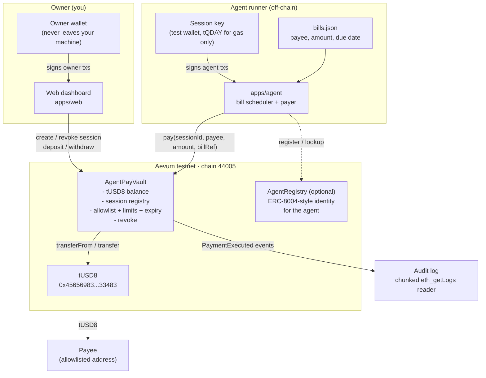
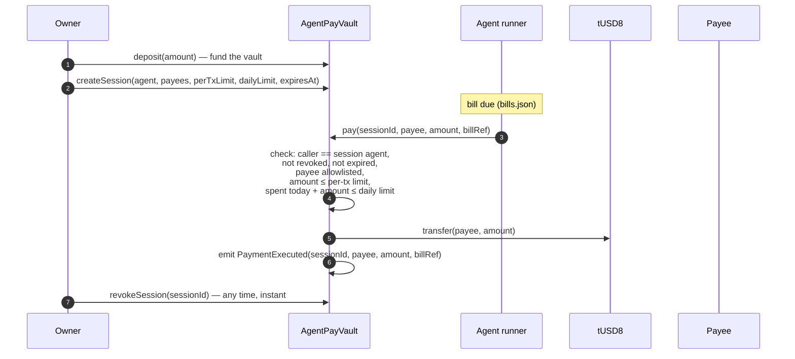

# AgentPay — autonomous stablecoin bill payments on Aevum testnet

> **DRAFT — 20 Nov 2026.** This README is written ahead of the build so the
> docs workstream and the build workstream agree on the target. Every value
> that does not exist yet is marked `[TODO]`. Do not treat a `[TODO]` value
> as a fact. The build workstream fills them in as contracts are deployed
> and the demo is recorded.
>
> Entry for **Aevum Builder Challenge #1** (DoraHacks), track
> **Native AI Assistants**. Submission deadline: **11 Dec 2026, 16:00 HKT
> (08:00 UTC / 15:00 WIB)**. All code is written inside the build window
> 16 Nov – 11 Dec 2026; all contracts run on Aevum testnet (chain 44005)
> with test tokens only.

**One-liner:** An AI agent pays your recurring bills in tUSD8 from a vault
you own — inside a payee allowlist, per-transaction and daily spending
limits, and an expiry you set — and you can revoke its access instantly,
with every payment leaving a verifiable on-chain audit trail.

## The problem

Recurring payments are still manual, brittle, or over-privileged:

- Paying every subscription, invoice, or scheduled transfer by hand is
  slow and easy to miss.
- Giving an AI agent your wallet key (or an unlimited token approval) so
  it can "pay for you" hands it your whole balance. A compromised key, a
  runaway loop, or a prompt-injection attack can drain everything.
- Existing "agent pays" demos usually settle off-chain or on another
  network, so there is no verifiable, on-chain record of *who* paid
  *whom*, *how much*, and *under what authority*.

## The solution

AgentPay splits **money** from **permission**:

- **The vault holds the money.** tUSD8 sits in `AgentPayVault`, a contract
  owned by you. Only the owner can deposit and withdraw.
- **The agent holds a narrow session key.** The owner creates a session
  that authorises one agent address to pay **only** allowlisted payees,
  **only** up to a per-transaction limit and a daily limit, and **only**
  until an expiry timestamp. The session key can never withdraw funds to
  itself, change the allowlist, or extend its own limits.
- **Revocation is instant and on-chain.** `revokeSession` takes effect in
  the next block; the agent's next payment reverts.
- **Every payment is auditable.** Each payment emits an event with the
  session id, payee, amount, and bill reference, readable from the
  explorer or the audit reader in this repo.
- **Scheduling lives off-chain; enforcement lives on-chain.** A small
  agent runner watches a bill schedule (a JSON file) and calls `pay`
  when a bill is due. If the runner is compromised or buggy, the
  contract — not the runner — is the last line of defence.

## Architecture



### Payment flow (sequence)



## Repository layout

```text
agentpay/
├── contracts/            # Foundry project
│   ├── src/
│   │   ├── AgentPayVault.sol    # vault + session keys + limits + revoke
│   │   └── AgentRegistry.sol    # [TODO] optional ERC-8004-style identity registry
│   ├── test/                    # unit tests (local, no network)
│   │   └── fork/                # fork tests against real tUSD8 on Aevum
│   └── script/                  # deploy scripts (forge script, --legacy)
├── apps/
│   ├── web/              # owner dashboard (create/revoke sessions, audit log)
│   └── agent/            # off-chain bill scheduler + payer (Node.js)
│       └── bills.json.example   # bill schedule template
└── docs/
    ├── README-DRAFT.md              # this file (draft source)
    └── DORAHACKS-SUBMISSION-DRAFT.md
```

## Tech stack

| Layer | Technology | Why |
| --- | --- | --- |
| Smart contracts | Solidity, Foundry (`forge`, `cast`, `anvil`) | Standard EVM toolchain; Aevum is EVM-compatible |
| EVM target | **Shanghai** (`evm_version = "shanghai"`) | Aevum does not support Cancun opcodes (`MCOPY`, `TSTORE`/`TLOAD`, blob ops) — Cancun bytecode deploys then reverts with `invalid opcode` |
| Token | tUSD8 (ERC-20, 6 decimals, EIP-2612 `permit`, EIP-3009) | The challenge stablecoin on Aevum |
| Frontend | `[TODO: framework — build workstream decides]` | Owner dashboard; must work on desktop and mobile |
| Agent runner | Node.js 22+, TypeScript, viem/ethers | Signs with the session key, polls the bill schedule |
| Chain reads | HTTPS JSON-RPC polling, chunked `eth_getLogs` (≤ 1,000 blocks per call) | Aevum has no working WebSocket RPC per the starter kit, and `eth_getLogs` over > 1,000 blocks fails |
| Transactions | Legacy (type 0) | Aevum tooling sends legacy txs, like QDay's own faucet |

## Testnet addresses

All activity is on **QDay Aevum Testnet** — chain ID **44005**
(`0xABE5`), RPC `https://rpc-test.qday.info`, explorer
<https://explorer-test.qday.info>, gas token tQDAY (18 decimals,
~1 gwei).

| Contract / token | Address | Explorer |
| --- | --- | --- |
| tUSD8 | `0x456569838f1d43009A91ebA4263147Afd7233483` | [explorer](https://explorer-test.qday.info/address/0x456569838f1d43009A91ebA4263147Afd7233483) |
| AgentPayVault | `[TODO — fill after deploy]` | `[TODO]` |
| AgentRegistry (optional) | `[TODO — fill after deploy, if built]` | `[TODO]` |
| Multicall3 | `0xcA11bde05977b3631167028862bE2a173976CA11` | — |
| Deployer / owner (test wallet) | `[TODO — fill after deploy]` | `[TODO]` |
| Demo agent session key (test wallet) | `[TODO — fill after deploy]` | `[TODO]` |

> Contract verification on the Aevum explorer is not working yet, so
> `forge verify-contract` fails for now. Verify this deployment instead
> by the addresses above plus the exact commit that was deployed:
> `[TODO — commit hash at deploy time]`.

## Prerequisites

- Node.js 22+ and `pnpm`
- Foundry (`foundryup`): `forge`, `cast`, `anvil`
- A test-only wallet (MetaMask or a Foundry keystore account). **Never
  use a wallet that holds real funds.** Never paste a private key into
  chat, an issue, or a committed file.

## Quickstart — reproduce the whole demo locally

A stranger should be able to run this end to end in ~15 minutes, with
no funds and no account. Everything below runs against a local fork of
Aevum, so nothing touches the real testnet.

```bash
# 1. Clone and install
git clone [TODO: public GitHub repo URL]
cd agentpay
# [TODO: exact install commands — build workstream fills in, e.g.]
# pnpm install && forge build

# 2. Configure (no secrets needed for the local fork)
cp apps/agent/.env.example apps/agent/.env
cp apps/web/.env.example apps/web/.env.local   # if applicable

# 3. Terminal 1 — local copy of Aevum (chain 440050, Shanghai rules)
# [TODO: exact command — build workstream fills in, e.g.]
# anvil --fork-url https://rpc-test.qday.info --hardfork shanghai --chain-id 440050

# 4. Terminal 2 — deploy AgentPayVault to the fork and fund it with test tUSD8
# [TODO: exact commands — build workstream fills in, e.g.]
# forge script contracts/script/Deploy.s.sol --rpc-url http://127.0.0.1:8545 --broadcast
# cast call ... deal tUSD8 to the vault ...

# 5. Create a session key for the demo agent (owner signs; fork only)
# [TODO: exact command]

# 6. Run the agent once against the fork — it pays the due bill in bills.json.example
# [TODO: exact command, e.g. pnpm --filter agent run pay -- --once]

# 7. Read the audit trail (chunked log reader, 1,000 blocks at a time)
# [TODO: exact command, e.g. pnpm --filter agent run audit]
```

Expected result: the agent pays the due bill(s) in tUSD8 to the
allowlisted payee, the vault emits `PaymentExecuted` events, and the
audit command prints the payment with its transaction hash. A second
run pays nothing (the bill is already paid / not due).

## Deploy to Aevum testnet

```bash
# 1. Import the TEST deployer key into Foundry's encrypted keystore
#    (the key is asked once; a password is asked each time — never put
#    the raw key in a file or shell history)
cast wallet import aevum-deployer --interactive
cast wallet address --account aevum-deployer

# 2. Fund the deployer: Discord faucet (recommended for challenge
#    participants) — join the QDay Discord, react ✅ in #verify, then
#    `/faucet <address>`; you get 1 tQDAY + 5 tUSD8, once per Discord
#    account and once per address. The web faucet (faucet.qday.info)
#    only pays addresses holding a little ETH, USDT or USDC on
#    Ethereum mainnet.

# 3. Deploy (legacy transactions; Shanghai EVM)
# [TODO: exact command — build workstream fills in, e.g.]
# forge script contracts/script/Deploy.s.sol --rpc-url https://rpc-test.qday.info \
#   --account aevum-deployer --broadcast --legacy

# 4. Record the deployed addresses + commit hash in "Testnet addresses"
#    above, and in the DoraHacks submission.
```

## Environment variables

| Variable | Required | Default | Description |
| --- | --- | --- | --- |
| `AEVUM_RPC_URL` | No | `https://rpc-test.qday.info` | Aevum testnet HTTPS RPC |
| `CHAIN_ID` | No | `44005` | Aevum testnet (`440050` for the local fork) |
| `TUSD8_ADDRESS` | No | `0x456569838f1d43009A91ebA4263147Afd7233483` | tUSD8 token |
| `VAULT_ADDRESS` | Yes (testnet) | — | Deployed `AgentPayVault` |
| `AGENT_REGISTRY_ADDRESS` | No | — | Deployed `AgentRegistry`, if used |
| `AGENT_PRIVATE_KEY` | Yes (agent) | — | **Session key only.** A test wallet holding tQDAY for gas. It can only pay allowlisted payees within the session limits. Never the owner key. Never commit it. |
| `OWNER_ADDRESS` | Yes (web) | — | Vault owner address (for the dashboard) |
| `BILLS_FILE` | No | `apps/agent/bills.json` | Bill schedule the agent watches |
| `POLL_INTERVAL_MS` | No | `[TODO]` | How often the runner checks for due bills |

See `apps/agent/.env.example` and `apps/web/.env.example` for the
authoritative list. `.env` files are git-ignored; never commit one.

## Usage

### Owner (web dashboard)

1. Connect your wallet (Aevum testnet, chain 44005).
2. **Deposit** tUSD8 into the vault (approve + deposit).
3. **Create a session**: pick the agent address, the allowlisted payees,
   the per-transaction limit, the daily limit, and the expiry. Sign once.
4. **Watch the audit log**: every payment appears with its bill
   reference and explorer link.
5. **Revoke** a session at any time — the agent's next payment reverts.
6. **Withdraw** remaining funds whenever you want.

### Agent (runner)

```bash
# [TODO: exact CLI — build workstream fills in]
pnpm --filter agent run pay -- --once      # pay all due bills once, then exit
pnpm --filter agent run pay -- --watch     # keep watching the schedule
pnpm --filter agent run bills              # list bills and their status
pnpm --filter agent run audit              # print the on-chain payment history
```

Bill schedule format (`apps/agent/bills.json`):

```json
{
  "bills": [
    {
      "id": "rent-dec",
      "payee": "0x0000000000000000000000000000000000000000",
      "amount": "50.00",
      "token": "tUSD8",
      "dueAt": "2026-12-01T00:00:00Z",
      "recurrence": "monthly",
      "reference": "rent-dec-2026"
    }
  ]
}
```

> The schedule is off-chain configuration; the chain enforces the
> money rules. If a bill's payee is not allowlisted, or its amount
> exceeds the session limits, `pay` reverts and the runner logs the
> failure instead of paying.

## Contract API reference

`AgentPayVault` — `[TODO: confirm final function list against the
implementation before submit]`.

### Owner functions (only `owner`)

| Function | Description |
| --- | --- |
| `deposit(uint256 amount)` | Pull tUSD8 from the owner into the vault (owner must `approve` first). Emits `Deposited`. |
| `withdraw(uint256 amount)` | Send tUSD8 from the vault back to the owner. Emits `Withdrawn`. |
| `createSession(address agent, address[] payees, uint256 perTxLimit, uint256 dailyLimit, uint256 expiresAt) returns (bytes32 sessionId)` | Authorise an agent address with a payee allowlist, per-transaction limit, daily limit (UTC-day window), and expiry. Emits `SessionCreated`. |
| `revokeSession(bytes32 sessionId)` | Instantly revoke a session. Emits `SessionRevoked`. |
| `transferOwnership(address newOwner)` | `[TODO — only if implemented]` |

### Agent functions (only the session's agent address)

| Function | Description |
| --- | --- |
| `pay(bytes32 sessionId, address payee, uint256 amount, bytes32 billRef)` | Pay `amount` tUSD8 to `payee`. Reverts unless: caller is the session agent, session is not revoked, `block.timestamp <= expiresAt`, `payee` is allowlisted, `amount <= perTxLimit`, and `spentToday + amount <= dailyLimit`. Emits `PaymentExecuted`. |

### Views

| Function | Description |
| --- | --- |
| `sessionOf(bytes32 sessionId)` | Session config: agent, limits, expiry, revoked flag. |
| `spentToday(bytes32 sessionId)` | Amount spent in the current UTC-day window. |
| `isPayeeAllowed(bytes32 sessionId, address payee)` | Allowlist check. |
| `balance()` | Vault tUSD8 balance. |

### Events (the audit trail)

```solidity
event Deposited(address indexed owner, uint256 amount);
event Withdrawn(address indexed owner, uint256 amount);
event SessionCreated(bytes32 indexed sessionId, address indexed agent,
                     uint256 perTxLimit, uint256 dailyLimit, uint256 expiresAt);
event SessionRevoked(bytes32 indexed sessionId);
event PaymentExecuted(bytes32 indexed sessionId, address indexed payee,
                      uint256 amount, bytes32 indexed billRef);
```

### `AgentRegistry` (optional)

`[TODO — only if the build workstream ships it.]` A minimal
ERC-8004-style identity registry deployed by us on Aevum, so the agent
has an on-chain identity (agent id + registration URI) that other
builders can discover. This is **our own** deployment: QDay's official
ERC-8004 registry is still in internal testing and is not open for
this challenge (see "Platform integration notes").

## Security model

- **Least privilege.** The session key can do exactly one thing: pay
  allowlisted payees within limits. It cannot withdraw, cannot change
  the allowlist or limits, cannot extend its expiry, and cannot create
  sessions.
- **Blast radius is capped.** The most a compromised session key can
  move is the daily limit, to allowlisted payees only — and only until
  the owner revokes it (one transaction) or it expires.
- **Owner key isolation.** The owner key never touches the agent host.
  The agent host holds only the session key, a test wallet with a
  little tQDAY for gas.
- **Idempotency.** Each bill payment is keyed by `billRef`; paying the
  same bill twice `[TODO — confirm: reverts / is skipped by the runner]`.
- **Auditability.** Every state change emits an event; the audit reader
  reconstructs the full history from chain data (chunked reads, 1,000
  blocks at a time).
- **Testnet only.** Test tokens, no real money, no mainnet deployment
  in this repo.

## Testing

```bash
# [TODO: exact commands — build workstream fills in]
forge test                 # unit tests (local, no network)
forge test --match-path test/fork/   # fork tests against real tUSD8
```

`[TODO: test count + coverage — fill in before submit. Target: every
rule in the Security model section has a test — allowlist rejection,
per-tx limit, daily limit, expiry, revoke, non-agent caller, double
payment.]`

## Known limitations

1. **Scheduling is off-chain.** The runner must be running for bills to
   be paid; there is no on-chain cron on Aevum. If the runner is down,
   bills wait. (Roadmap: a keeper network / automation service.)
2. **No public paymaster / bundler (yet).** The starter kit confirms
   there is no officially supported bundler or paymaster and no public
   paymaster that takes tUSD8, so the agent pays gas in tQDAY. Gasless
   payment via EIP-3009 + relayer is a roadmap item, not v1.
3. **QDay's ERC-8004 registry is not open.** It is still in internal
   testing and "isn't open for this challenge", so AgentPay keeps its
   own name-to-address mapping and (optionally) deploys its own
   reference registry. Our registry is not the official one.
4. **Shanghai EVM.** No Cancun opcodes; OpenZeppelin `*Transient`
   contracts are unusable.
5. **Explorer verification does not work yet.** Verify deployments via
   the addresses + exact commit in this README.
6. **Log reads are chunked.** `eth_getLogs` fails over > 1,000 blocks;
   the audit reader chunks from the deploy block.
7. **No WebSocket RPC** (per the starter kit). The dashboard and runner
   poll over HTTPS.
8. **Single owner per vault (v1).** No multisig owner yet.
9. **Testnet only.** tUSD8 has no real value; nothing here is a
   production payment system.

## Roadmap

- [ ] **v1.1 — Gasless agent payments.** EIP-3009 `receiveWithAuthorization`
      + relayer (the starter kit's gasless checkout pattern), so the
      session key needs no tQDAY.
- [ ] **v1.2 — ERC-4337 smart account.** Adopt QDay's smart accounts /
      paymaster **when** QDay publishes bundler + paymaster addresses
      and docs (announced as live on testnet, but no addresses or
      endpoints are published as of 20 Nov 2026).
- [ ] **v1.3 — x402 bills.** Pay-per-use API bills through QDay's x402
      facilitator once its endpoint is published.
- [ ] **v1.4 — Keeper network.** Decentralised scheduling so bills are
      paid even if the owner's runner is offline.
- [ ] **v2 — Multisig owner, multi-vault, ERC-8004 reputation.**
      Reputation feedback for agents; mainnet when QDay mainnet
      launches (scheduled Q1 2027).

## Platform integration notes (for the judges)

How AgentPay uses — and does not use — QDay platform features, verified
20 Nov 2026:

| Feature | QDay status (20 Nov 2026) | What AgentPay does |
| --- | --- | --- |
| tUSD8 payments on Aevum | Live; `0x4565…3483` | All value movement is tUSD8 on Aevum testnet (chain 44005). |
| Session keys, spending limits, expiry, revoke | QDay's agent wallets / session keys are announced as live on testnet (qday.io/build), **but no contract addresses, endpoints, or SDK are published**, and the starter kit says to write budgets, limits, expiry and revoke "into your own contract" | Implemented in `AgentPayVault` itself — the design the starter kit recommends. |
| ERC-4337 smart accounts + paymaster | Announced as live on testnet; the starter kit FAQ says there is "no officially supported bundler or paymaster" and "no public paymaster that takes tUSD8 yet" | Not used in v1; roadmap item for when addresses are published. |
| x402 facilitator | Announced as live on testnet; no endpoint published | Not used in v1; roadmap item. |
| ERC-8004 registry | Still in internal testing; "isn't open for this challenge" (starter kit) | AgentPay optionally deploys its **own** reference registry; name-to-address mapping lives in our contract. |
| EIP-3009 gasless pattern | Works today (starter kit) | Roadmap (v1.1). |

Sources: <https://qday.io/build>,
<https://wiki.qday.info/guide/handbook/why-qday/>,
<https://aevum-starter-kit.vercel.app/docs>,
<https://dorahacks.io/hackathon/qday/detail> (all checked 20 Nov 2026).

## Demo

- **Live demo:** `[TODO — URL]`
- **Demo video:** `[TODO — URL, 3–5 min walkthrough]`
- **Example transactions (testnet):** `[TODO — tx hashes + explorer links
  showing: deposit, session creation, agent payment, revoke]`

Top-5 finalists present a 3–5 minute live walkthrough on a video call
on Demo Day, 15 Dec 2026.

## License

`[TODO — MIT or Apache 2.0; build workstream decides. A permissive
open-source license is required by the challenge.]`

## Credits

- `[TODO — confirm]` Based on the Aevum Starter Kit (MIT, © 2026 PQA
  Labs) — keep its `LICENSE` file / copyright notice if any kit code is
  reused, and credit borrowed snippets at their use site.
- QDay / Aevum testnet, tUSD8, and the challenge organisers.
- `[TODO — third-party dependencies and their licenses, or a NOTICE file]`

---

*Built for Aevum Builder Challenge #1 · Native AI Assistants track ·
QDay Aevum Testnet (chain 44005) · testnet only, no real funds.*
